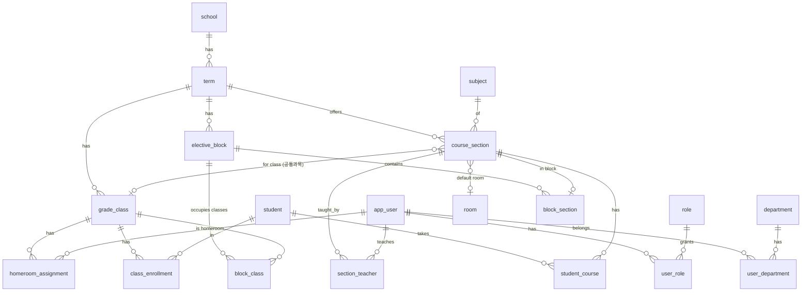
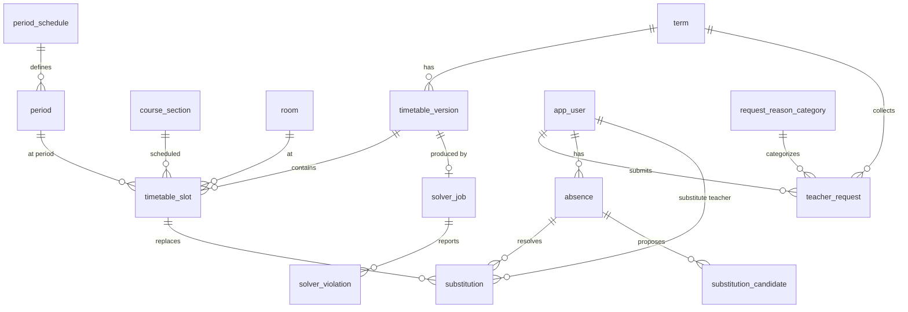
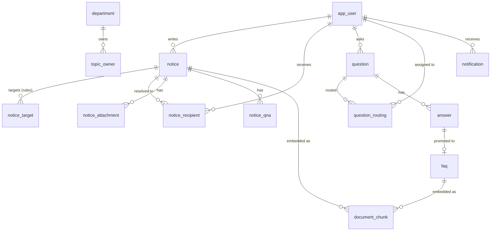
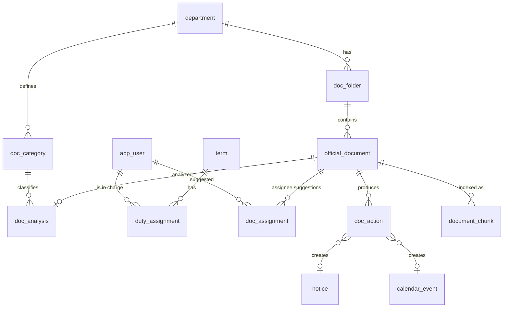

# DB 설계 문서 (v0.1 초안)

> PostgreSQL 16 + pgvector — 작성일 2026-11-22
> 관련 문서: [기능 명세서](./functional-spec.md)

## 1. 설계 원칙

- **PK**: `bigint generated always as identity` (외부 노출용 식별자가 필요하면 `uuid` 컬럼 추가).
- **시간**: 모든 시각은 `timestamptz`, 날짜는 `date`. 학교 시간대는 `Asia/Seoul` 설정값.
- **공통 컬럼**: `created_at`, `updated_at` (트리거로 갱신). 삭제는 기본 소프트 삭제(`deleted_at`)가 필요한 테이블만.
- **학기 단위 분리**: 학급·편제·시간표는 학기(`term`)에 속한다. 학기가 바뀌어도 과거 데이터는 그대로 남는다.
- **원본 + 변경 이력 분리**: 기본 시간표(`timetable_slot`)와 교체(`substitution`)를 분리하고, "실제 시간표"는 뷰/쿼리로 합친다.
- **대상 지정은 규칙으로 저장 후 수신자 확정(스냅샷)**: 발송 시점의 수신자 명단을 `notice_recipient`에 확정해 이후 인사 변동과 무관하게 이력이 보존된다.
- **열거형**: 자주 바뀔 수 있는 값은 참조 테이블, 고정적인 상태값은 PostgreSQL `enum` 또는 `text + check`.
- **ORM: Prisma + raw SQL 마이그레이션 병행**(2026-11-22 확정).
  - 테이블·컬럼·일반 관계·인덱스는 Prisma 스키마(`schema.prisma`)로 관리하고 `prisma migrate`로 마이그레이션을 만든다.
  - Prisma가 표현하지 못하는 것은 같은 마이그레이션 폴더에 SQL로 직접 추가한다: pgvector 확장과 `vector` 컬럼·HNSW 인덱스(Prisma에서는 `Unsupported("vector(1024)")`), 부분 유니크 인덱스(`WHERE` 조건), 트리거(`updated_at`, 확정 버전 겹침 검증), 뷰(`v_daily_timetable` 등), `check` 제약.
  - 벡터 검색·뷰 조회처럼 Prisma 쿼리로 불편한 곳은 `prisma.$queryRaw`(타입 지정)로 작성한다.
  - 규칙: 스키마를 바꿀 때는 항상 `prisma migrate dev --create-only`로 마이그레이션을 만든 뒤 필요한 SQL을 덧붙이고 적용한다. DB를 직접 고치지 않는다.

## 2. 모듈 구성

| 모듈 | 테이블 |
|---|---|
| 조직·계정 | `school`, `term`, `app_user`, `department`, `user_department`, `role`, `user_role` |
| 학급·학생 | `grade_class`, `homeroom_assignment`, `student`, `class_enrollment` |
| 교육과정 | `subject`, `room`, `course_section`, `section_teacher`, `student_course` |
| 학점제 블록 | `elective_block`, `block_section`, `block_class` |
| 시정·시간표 | `period_schedule`, `period`, `day_period_override`, `timetable_version`, `timetable_slot` |
| 시간표 편성 | `teacher_request`, `request_reason_category`, `constraint_weight`, `solver_job`, `solver_violation` |
| 교체 | `absence`, `substitution`, `substitution_candidate` |
| 안내·할 일 | `notice`, `notice_target`, `notice_recipient`, `notice_attachment`, `notice_qna`, `recipient_group`, `recipient_group_member` |
| 급식 | `meal`, `allergen` |
| 학사일정 | `calendar_event` |
| 질문 라우팅 | `question`, `question_routing`, `answer`, `faq`, `topic_owner`, `document_chunk` |
| 알림 | `notification`, `notification_preference` |
| 공문 자동 처리 | `doc_folder`, `official_document`, `doc_analysis`, `doc_category`, `duty_assignment`, `doc_assignment`, `doc_action` |
| 운영 | `audit_log`, `backup_run`, `app_setting`, `external_sync_run`, `batch_job`, `retention_run`, `retention_hold` |

## 3. ERD

### 3.1 조직·학급·교육과정

### 3.2 시간표·편성·교체

### 3.3 안내·질문·알림

### 3.4 공문 자동 처리

## 4. 테이블 정의

표기: **PK** 기본키, **FK** 외래키, **UQ** 유니크, `?` NULL 허용.

### 4.1 조직·계정

**school** — 학교(단일 학교 운영이지만 NEIS 코드 보관용)
| 컬럼 | 타입 | 설명 |
|---|---|---|
| id | bigint PK | |
| name | text | 학교명 |
| neis_office_code | text | 시도교육청 코드(ATPT_OFCDC_SC_CODE) |
| neis_school_code | text | 표준학교코드(SD_SCHUL_CODE) |
| timezone | text | 기본 `Asia/Seoul` |

**term** — 학기
| 컬럼 | 타입 | 설명 |
|---|---|---|
| id | bigint PK | |
| school_id | FK school | |
| year | int | 학년도 |
| semester | smallint | 1, 2 |
| start_date, end_date | date | |
| is_current | boolean | 현재 학기 (부분 UQ: true는 하나만) |

**app_user** — 교직원 계정
| 컬럼 | 타입 | 설명 |
|---|---|---|
| id | bigint PK | |
| login_id | text UQ | 1단계 아이디 = 한글 이름, 중복 시 `홍길동2`… 등록 순(생성 후 변경 불가) |
| password_hash | text? | 로컬 로그인용(1단계 전원, 2단계는 비상용 관리자만) |
| must_change_password | boolean | 첫 로그인 비밀번호 변경 강제 |
| failed_login_count | smallint | 5회 실패 시 잠금 |
| email | text? UQ | Google Workspace 계정 이메일(2단계 연결 시) |
| google_sub | text? UQ | Google 계정 고유 ID(OIDC `sub`), 2단계 연결 시 저장 |
| name | text | |
| phone | text? | |
| main_subject_id | FK subject? | 주 담당 교과 |
| max_weekly_hours | smallint? | 주당 최대 시수 |
| is_active | boolean | 전출·퇴직 시 false(삭제하지 않음). 비활성 계정은 로그인 불가, 수신자·담당자 후보에서 제외, 과거 기록에는 이름 유지 |

**department** — 부서 (교무부, 학생부, 과학과 등; `kind`로 행정부서/교과협의회 구분)
| id PK | name | kind (`admin`/`subject`) | parent_id FK department? |

**user_department** — (user_id, department_id) PK, `is_head` boolean(부장 여부)

**role** — `code` UQ (`sys_admin`, `approver`, `timetable_admin`, `dept_staff`, `teacher`), name

**user_role** — id PK, user_id FK, role_id FK, `scope_department_id?`, `scope_grade?` (역할의 적용 범위)

### 4.2 학급·학생

**grade_class** — 학급
| 컬럼 | 타입 | 설명 |
|---|---|---|
| id | bigint PK | |
| term_id | FK term | |
| grade | smallint | 학년 |
| class_no | smallint | 반 |
| home_room_id | FK room? | 학급 교실 |
| UQ | (term_id, grade, class_no) | |

**homeroom_assignment** — 담임/부담임
| id PK | class_id FK grade_class | user_id FK app_user | kind (`main`/`assistant`) |

**student** — 학생 (**학번만 저장, 이름 저장 안 함** — 2026-11-22 확정)
| id PK | is_active boolean | created_at |

> 학생 이름·연락처 등 개인정보는 저장하지 않는다. 학번(예: 20315 = 2학년 3반 15번)은 해마다 바뀌므로 학생 행에는 두지 않고 학기별 소속(`class_enrollment`)에 둔다. 해가 바뀌어도 같은 학생으로 이어 보려면 새 학년 엑셀 가져오기 때 "이전 학번" 열로 연결한다.

**class_enrollment** — 학기별 소속과 학번
| class_id FK grade_class | student_id FK student | student_no text (학번) | PK(class_id, student_id) | UQ(학기, student_no) |

### 4.3 교육과정

**subject** — 교과목
| id PK | name | subject_group (국어/수학/…) | credits smallint? | required_room_type text? |

**room** — 교실
| 컬럼 | 타입 | 설명 |
|---|---|---|
| id | bigint PK | |
| name | text | |
| room_type | text | `general`, `science_lab`, `computer`, `gym`, `music`, … |
| capacity | smallint? | |
| is_schedulable | boolean | 편성 대상 여부 |

**course_section** — 수업 단위(편제의 한 줄). 공통과목은 학급 단위, 선택과목은 분반 단위.
| 컬럼 | 타입 | 설명 |
|---|---|---|
| id | bigint PK | |
| term_id | FK term | |
| subject_id | FK subject | |
| class_id | FK grade_class? | 공통과목이면 해당 반, 선택과목이면 NULL |
| section_name | text | 예: "2-3 수학Ⅰ", "물리학Ⅱ A반" |
| weekly_hours | smallint | 주당 시수 |
| room_type | text? | 필요 교실 유형 |
| default_room_id | FK room? | |
| max_daily_hours | smallint | 하루 최대 시수(기본 1, 블록타임 과목은 2) |
| consecutive_rule | text | `none`, `prefer_double`, `require_double`(과학탐구실험·블록타임 과목). 하루 2시간이면 연속 필수 |

**section_teacher** — (section_id, user_id) PK, `hours_share smallint?` (공동 수업·시수 분할)

**student_course** — 학생 수강(학점제) (student_id, section_id) PK

### 4.4 학점제 선택과목 블록

**elective_block** — 같은 시간대에 동시 개설되는 선택과목 묶음
| 컬럼 | 타입 | 설명 |
|---|---|---|
| id | bigint PK | |
| term_id | FK term | |
| grade | smallint | 대상 학년 |
| name | text | 예: "2학년 선택A" |
| weekly_hours | smallint | 블록이 차지하는 주당 시수 |

**block_section** — 블록 소속 분반. section_id UQ(한 분반은 한 블록에만)
| block_id FK | section_id FK course_section |

**block_class** — 블록 시간에 수업이 비워져야 하는 학급(그 학급 학생들이 블록 과목을 들으러 흩어짐)
| block_id FK | class_id FK grade_class |

> 제약 검증(애플리케이션/솔버): 한 학생이 듣는 두 분반이 같은 블록에 있으면 안 됨.

### 4.5 시정·시간표

**period_schedule** — 시정표(정상, 단축수업 등)
| id PK | name | is_default boolean |

**period** — 교시 정의
| id PK | schedule_id FK | period_no smallint | start_time time | end_time time | is_class boolean (점심·조회 구분) |

**weekday_period_count** — 요일별 교시 수: (schedule_id, day_of_week) PK, period_count smallint (기본 시정: 월·화·목·금 7, 수 4)

**day_period_override** — 특정 날짜의 시정 변경 (date PK, schedule_id FK, note)

**timetable_version** — 시간표 버전(편성 결과·수동 수정본)
| 컬럼 | 타입 | 설명 |
|---|---|---|
| id | bigint PK | |
| term_id | FK term | |
| name | text | 예: "1차 편성안", "확정본" |
| status | text | `draft`, `confirmed`, `archived` |
| source | text | `solver`, `manual`, `import` |
| created_by | FK app_user | |
| confirmed_at | timestamptz? | |

> 같은 학기에 `confirmed` 버전은 하나만(부분 유니크 인덱스). 학기 중 변경은 기본 시간표를 바꾸지 않고 교체(`substitution`)로만 처리한다(2026-11-22 확정).

**timetable_slot** — 기본 시간표 한 칸
| 컬럼 | 타입 | 설명 |
|---|---|---|
| id | bigint PK | |
| version_id | FK timetable_version | |
| section_id | FK course_section | |
| day_of_week | smallint | 1(월)~5(금) |
| period_no | smallint | |
| room_id | FK room? | |
| is_locked | boolean | 담당자가 고정한 칸(재편성 시 유지) |
| UQ | (version_id, section_id, day_of_week, period_no) | |

> 교사·교실·학급 중복은 솔버가 보장하고, DB에서도 확정 시 검증 쿼리로 재확인한다. 블록 수업은 블록 내 각 분반이 같은 (요일, 교시)에 슬롯을 가진다.

**실제 시간표 조회** — 뷰 `v_daily_timetable(date, …)`: 해당 날짜의 확정 버전 슬롯 + `substitution`(승인된 것) 적용 + `day_period_override` 반영.

### 4.6 시간표 편성(솔버)

**priority_policy** — 인사자문위원회가 의결한 학기별 우선순위 정책
| 컬럼 | 타입 | 설명 |
|---|---|---|
| id | bigint PK | |
| term_id | FK term | |
| version | smallint | 같은 학기 안에서 재의결 시 증가 |
| decided_on | date | 위원회 의결일 |
| minutes_file_path | text? | 회의록 첨부 |
| max_requests_per_teacher | smallint | 교사당 요청 상한 |
| max_strong_requests | smallint | 교사당 "강한 요청" 상한 |
| fairness_bonus_enabled | boolean | 직전 학기 반영률 보정 사용 여부 |
| status | text | `draft`, `active`, `superseded` |
| entered_by | FK app_user | 입력한 시간표 담당자 |
| locked_at | timestamptz? | 요청 수집 시작 시 잠금 |

**request_reason_category** — 요청 사유 범주와 계수(정책 버전에 속함)
| id PK | policy_id FK priority_policy | name (육아, 건강, 대학원, 기타…) | weight_factor numeric | requires_evidence boolean |

**teacher_request** — 교사 요청(희망/회피 조건)
| 컬럼 | 타입 | 설명 |
|---|---|---|
| id | bigint PK | |
| term_id | FK term | |
| user_id | FK app_user | |
| raw_text | text? | 교사가 입력한 자연어 원문 |
| kind | text | `avoid_time`, `prefer_time`, `max_consecutive`, `daily_max`, `daily_min`, `day_off`, `unavailable`(절대) |
| params | jsonb | 예: `{"days":[4],"periods":[5,6,7]}`, `{"max":2}` |
| is_hard | boolean | 절대 조건 여부(불가 시간 등, 담당자 승인 필요) |
| priority_rank | smallint | 교사가 매긴 순위(1이 가장 중요) |
| reason_category_id | FK request_reason_category? | |
| status | text | `draft`(LLM 변환 후 교사 확인 전), `submitted`, `approved`, `rejected` |
| reviewed_by | FK app_user? | |

**constraint_weight** — 유형별 기본 가중치·순위 계수(관리자 설정, 학기별)
| id PK | term_id FK | kind text | base_weight int | rank_factors jsonb (예: `{"1":3,"2":2,"3":1}`) | updated_by FK |

**solver_job** — 편성/교체 추천 작업
| 컬럼 | 타입 | 설명 |
|---|---|---|
| id | bigint PK | |
| term_id | FK term | |
| job_type | text | `block_assign`, `timetable`, `substitution` |
| status | text | `queued`, `running`, `succeeded`, `infeasible`, `failed`, `cancelled` |
| input_snapshot | jsonb | 실행 시점 입력 전체(재현·감사용) |
| params | jsonb | 제한 시간, 시드 등 |
| objective_value | bigint? | 총 벌점 |
| result_version_id | FK timetable_version? | 결과로 생성된 버전 |
| diagnostics | jsonb? | infeasible 원인 등 |
| started_at, finished_at | timestamptz? | |
| requested_by | FK app_user | |

**solver_violation** — 결과에서 지켜지지 못한 희망 조건
| id PK | job_id FK | request_id FK teacher_request? | kind | penalty int | detail jsonb |

### 4.7 교체

**absence** — 결원/교체 요청
| 컬럼 | 타입 | 설명 |
|---|---|---|
| id | bigint PK | |
| user_id | FK app_user | 결원 교사 |
| date | date | |
| periods | smallint[] | 해당 교시(전일이면 전체) |
| reason | text | `business_trip`, `leave`, `sick`, `other` |
| note | text? | |
| status | text | `requested`, `resolved`, `cancelled` |
| created_by | FK app_user | |

**substitution_candidate** — 솔버가 추천한 교체안
| id PK | absence_id FK | rank smallint | plan jsonb (칸별 변경 내역) | score int | metrics jsonb (영향 교사 수, 연강 발생, 누적 보강) | solver_job_id FK? |

**substitution** — 확정된 교체(칸 단위)
| 컬럼 | 타입 | 설명 |
|---|---|---|
| id | bigint PK | |
| absence_id | FK absence? | 맞교환은 absence 없이 생성 가능 |
| date | date | |
| original_slot_id | FK timetable_slot | |
| period_no | smallint | 교체 후 교시(맞교환 시 이동) |
| kind | text | `swap`, `cover`(보강), `self_study`(자습 감독), `cancel` |
| substitute_user_id | FK app_user? | |
| room_id | FK room? | |
| status | text | `proposed`, `accepted`(상대 수락), `approved`(담당자 승인, 필수), `rejected`, `cancelled` |
| approved_by | FK app_user? | |
| UQ | (date, original_slot_id) where status='approved' | |

> 교사별 보강 누적은 `substitution`에서 집계(뷰 `v_cover_count_by_teacher`).

### 4.8 안내·할 일

**notice** — 안내/할 일
| 컬럼 | 타입 | 설명 |
|---|---|---|
| id | bigint PK | |
| author_id | FK app_user | |
| department_id | FK department? | 발행 부서 |
| category | text | `notice`, `task`, `submission`, `meeting`, `event` |
| title | text | |
| body | text | Markdown |
| importance | text | `normal`, `high`, `urgent` |
| due_at | timestamptz? | 마감 |
| is_mandatory | boolean | 알림 끌 수 없음 |
| requires_completion | boolean | 할 일(완료 체크) 여부 |
| status | text | `draft`, `classifying`, `pending_review`(작성자 확인 대기), `published`, `closed`, `cancelled` |
| auto_classified | boolean | 전체 발송 자동 분류를 거쳤는지 |
| classification | jsonb? | LLM이 추론한 대상 규칙·이유·신뢰도(작성자 수정 전 원본) |
| is_all_mandatory | boolean | 필수 전체 공지(분류 없이 전원) |
| mandatory_set_by | FK app_user? | 필수 전체 공지로 지정한 관리자 |
| published_at | timestamptz? | |

**notice_target** — 대상 규칙(여러 행 = OR, 한 행 안의 조건 = AND)
| 컬럼 | 타입 | 설명 |
|---|---|---|
| id | bigint PK | |
| notice_id | FK notice | |
| target_type | text | `all`, `user`, `grade`, `class`, `department`, `role`, `homeroom`, `subject`, `group` |
| target_ref | jsonb | 예: `{"grade":2,"homeroom":true}`, `{"user_ids":[..]}`, `{"group_id":3}` |

**notice_recipient** — 발행 시점에 확정된 수신자와 개인별 상태
| 컬럼 | 타입 | 설명 |
|---|---|---|
| notice_id | FK notice | PK(notice_id, user_id) |
| user_id | FK app_user | |
| relevance | text | `action`(해야 함), `info`(참고) — 자동 분류 결과 또는 작성자 지정 |
| relevance_reason | text? | 분류 이유(작성자 미리보기용) |
| state | text | `unread`, `read`, `done`, `not_applicable` |
| feedback_irrelevant | boolean | 수신자가 "나와 관계없음"을 눌렀는지(분류 학습용) |
| read_at, done_at | timestamptz? | |
| last_reminded_at | timestamptz? | |

> 인덱스: `(user_id, state, notice_id)` — "내 할 일 목록" 조회용.

**notice_attachment** — id PK, notice_id FK, file_path, file_name, size, mime (파일은 로컬 디스크 Docker 볼륨 `uploads`에 저장, 파일명은 무작위 ID로 바꿔 저장하고 원래 이름은 `file_name`에 보관)
**notice_qna** — 안내에 붙는 추가 Q&A: id PK, notice_id FK, question text, answer text, source_question_id FK question?
**recipient_group** / **recipient_group_member** — 저장된 수신 그룹(동적이면 `rule jsonb`, 정적이면 멤버 테이블)

### 4.9 급식

**meal**
| 컬럼 | 타입 | 설명 |
|---|---|---|
| id | bigint PK | |
| meal_date | date | |
| meal_type | text | `breakfast`, `lunch`, `dinner` |
| dishes | jsonb | `[{"name":"우유","allergens":[2]}, …]` |
| calories | numeric? | |
| nutrition | jsonb? | |
| source | text | `neis`, `manual` |
| fetched_at | timestamptz | |
| UQ | (meal_date, meal_type) | |

**neis_timetable** — NEIS 시간표 수집본(대조용, 원본 아님)
| id PK | date | grade smallint | class_no smallint | period_no smallint | subject_name text | fetched_at timestamptz | UQ(date, grade, class_no, period_no) |

> 뷰 `v_timetable_neis_diff(date)`: `v_daily_timetable`과 비교해 과목이 다른 칸 목록.

**allergen** — 알레르기 번호표: code smallint PK, name text (1 난류, 2 우유, …)

### 4.10 학사일정

**calendar_event** — id PK, title, start_date, end_date, all_day, category, source (`neis`/`school`), target (jsonb, 대상 규칙), created_by FK?

### 4.11 질문 라우팅

**question**
| 컬럼 | 타입 | 설명 |
|---|---|---|
| id | bigint PK | |
| asker_id | FK app_user | |
| text | text | |
| intent | text? | `timetable`, `meal`, `calendar`, `notice`, `judgment`, `other` |
| intent_confidence | real? | |
| extracted_params | jsonb? | LLM이 뽑은 날짜·반·교시 등 |
| status | text | `auto_answered`, `routed`, `answered`, `closed` |
| related_notice_id | FK notice? | 특정 안내에 대한 질문이면 |
| related_class_id | FK grade_class? | |
| created_at | timestamptz | |

**answer**
| id PK | question_id FK | answered_by FK app_user? (NULL=자동) | body text | evidence jsonb (근거 데이터 참조: 테이블·id·링크) | helpful boolean? (질문자 피드백) | created_at |

**question_routing** — 사람에게 전달된 기록(재전달 포함)
| id PK | question_id FK | assignee_id FK app_user | rule text (`owner`, `homeroom`, `topic`, `manual`) | routed_at | responded_at? | escalated boolean |

**topic_owner** — 주제→담당 매핑
| id PK | topic text (출결, 방과후, 생기부…) | department_id FK | user_id FK? (특정 담당자) | keywords text[] |

**faq**
| 컬럼 | 타입 | 설명 |
|---|---|---|
| id | bigint PK | |
| question_text | text | 대표 질문 |
| answer_text | text | |
| source_answer_id | FK answer? | |
| owner_id | FK app_user | 유지 책임자 |
| visibility | jsonb | 대상 규칙(notice_target과 같은 형식) |
| valid_until | date? | 학기 바뀌면 재확인 |
| is_active | boolean | |

**document_chunk** — RAG용 임베딩(안내·FAQ·규정 문서)
| 컬럼 | 타입 | 설명 |
|---|---|---|
| id | bigint PK | |
| source_type | text | `notice`, `faq`, `regulation`, `notice_qna`, `official_doc` |
| source_id | bigint | |
| chunk_no | int | |
| content | text | |
| embedding | vector(1024) | 로컬 임베딩 모델 차원(bge-m3 가정, 모델 확정 시 조정) |
| visibility | jsonb | 권한 필터용 |

> 인덱스: `embedding`에 HNSW 인덱스. 검색 시 질문자 권한으로 `visibility` 필터를 먼저 적용해 보지 못할 문서가 답변 근거로 쓰이지 않게 한다.

### 4.12 공문 자동 처리

**doc_folder** — 부서별 공문 폴더
| id PK | department_id FK | inbox_path text (예: `공문/교무부/받은공문`) | done_path text | auto_publish_info_only boolean (`참고만` 자동 발행, 기본 false) | reviewer_user_id FK app_user? (지정 검토자, 없으면 부서장) |

**official_document** — 수집된 공문
| 컬럼 | 타입 | 설명 |
|---|---|---|
| id | bigint PK | |
| folder_id | FK doc_folder | |
| file_path | text? | 현재 위치. 정리(삭제) 후 NULL |
| original_name | text | |
| file_hash | text UQ | 중복 제거 |
| file_type | text | `pdf`, `hwp`, `hwpx`, `image`, `zip` |
| size_bytes | bigint | |
| title, sender_org, doc_number | text? | 기본정보(LLM 추출, 검토자 수정 가능) |
| issued_on | date? | 시행일자 |
| extracted_text | text? | 정리 시 삭제 |
| status | text | `queued`, `extracting`, `analyzing`, `pending_review`, `published`, `rejected`, `needs_attention`, `purged` |
| priority | text | `normal`, `urgent`("지금 처리") |
| received_at | timestamptz | 폴더에 들어온 시각 |
| processed_at, reviewed_at | timestamptz? | |
| reviewed_by | FK app_user? | |
| purge_after | date? | 정리 예정일(연결된 할 일 완료·마감 기준으로 계산) |
| purged_at | timestamptz? | |

**doc_analysis** — LLM 분석 결과(공문당 최신 1개, 재분석 시 교체)
| 컬럼 | 타입 | 설명 |
|---|---|---|
| document_id | PK, FK official_document | |
| summary | text | 3줄 요약 |
| todo_items | jsonb | `[{"what":"…","due":"2026-12-05","evidence":"원문 문장"}]` |
| handling_type | text | `info_only`, `notice_needed`, `submission`, `event` |
| category_ids | bigint[] | doc_category |
| target_rule | jsonb | F-NOTI 대상 규칙 초안 |
| confidence | jsonb | 항목별 신뢰도 |
| model | text | 사용한 모델·프롬프트 버전 |
| reviewer_edits | jsonb? | 검토자가 바꾼 내용(정확도 개선용) |

**doc_category** — 업무 분류표: id PK, department_id FK, name, keywords text[], is_active

**duty_assignment** — 업무분장표(학기별, 엑셀 가져오기)
| id PK | term_id FK | user_id FK app_user | department_id FK | duty_name text (예: 방과후학교) | keywords text[] | is_primary boolean (정/부 담당) |

**doc_assignment** — 담당자 추천과 확정
| id PK | document_id FK | user_id FK app_user | rank smallint | reason text | source (`duty_table`, `history`, `manual`) | is_final boolean |

**doc_action** — 자동화 결과물(초안 → 확인 시 발행)
| id PK | document_id FK | kind (`task`, `notice`, `calendar`, `index`, `file_move`, `digest`) | status (`draft`, `applied`, `discarded`) | payload jsonb | notice_id FK notice? | calendar_event_id FK calendar_event? | applied_at timestamptz? |

> `notice`·`calendar_event`에 `source_document_id`(FK official_document?) 컬럼을 추가해 어느 공문에서 나왔는지 추적한다.

### 4.13 야간 작업 큐·정리

**batch_job** — 야간 작업 큐(공문 처리·백업·정리·시간표 편성을 하나의 큐로)
| id PK | kind (`doc_process`, `backup`, `retention`, `solver`) | ref_id bigint? | priority smallint | window text (`night` 18:00~08:00, `now`) | status (`queued`, `running`, `done`, `failed`, `deferred`) | scheduled_for timestamptz | started_at, finished_at | error text? |

**retention_run** — 월간 정리 실행 기록
| id PK | run_month date | started_at | finished_at | status | deleted_counts jsonb (대상별 건수) | freed_bytes bigint | preview_shown_at timestamptz (관리자 사전 확인) |

**retention_hold** — 정리에서 제외("보존" 표시)
| id PK | target_type (`official_document`, `notice`, `notice_attachment` …) | target_id bigint | reason text | held_by FK app_user | until date? |

### 4.14 알림

**notification** — 개인 알림 큐
| id PK | user_id FK | kind (`notice`, `due_reminder`, `substitution`, `question_routed`, `answer`, `approval`) | ref_type, ref_id | title | is_urgent | delivered_at? | read_at? | digest_date date? (요약 알림 묶음) |

**notification_preference** — (user_id, category) PK, mode (`instant`/`digest`/`off`)

### 4.15 운영

**audit_log** — id PK, actor_id FK?, action text, target_type, target_id, detail jsonb, ip inet, created_at (추가만 가능, 수정·삭제 금지 권한)

**backup_run** — id PK, kind (`daily`/`weekly`/`monthly`/`restore_test`), started_at, finished_at, status, file_path, size_bytes, checksum, offsite_copied boolean, error text?

**external_sync_run** — NEIS 등 외부 수집 기록: id PK, source (`neis_meal`, `neis_calendar`, `neis_timetable`), started_at, status, rows, error

**app_setting** — key text PK, value jsonb (자동 분류 신뢰도 임계값, 미확인 시 자동 발송 대기 시간, LLM 임계값, NEIS 코드 등)

## 5. 주요 조회 시나리오와 인덱스

| 시나리오 | 쿼리 핵심 | 인덱스 |
|---|---|---|
| 내 할 일 목록(마감순) | notice_recipient(user, state≠done) ⋈ notice order by due_at | `notice_recipient(user_id, state)`, `notice(due_at)` |
| 오늘의 내 시간표 | 확정 버전 slot ⋈ section_teacher(user) + substitution(date) | `timetable_slot(version_id, day_of_week, period_no)`, `substitution(date)` |
| 특정 반 특정 교시 수업 | slot ⋈ section(class_id) ∪ block_class | `course_section(term_id, class_id)` |
| 교체 후보 교사 | 해당 교시 빈 교사 = 전체 교사 − 그 시간 수업 교사 − 결원 | slot 인덱스 + `absence(date)` |
| 내일 급식 | meal where meal_date | UQ(meal_date, meal_type) |
| 질문 RAG 검색 | document_chunk 권한 필터 + 벡터 유사도 | HNSW(embedding) |

## 6. 백업·복구 설계

- `worker` 컨테이너의 cron이 `pg_dump -Fc`로 매일 새벽 백업 → 백업 볼륨 저장 → 암호화 → 학교 NAS로 복사 → `backup_run`에 기록.
- 보관: 일간 7개, 주간 4개, **월간 3개(최대 약 90일)**. 저장 공간 절약 원칙에 맞춰 줄임(기능 명세 §10.1).
- 업로드 파일(`notice_attachment`)과 처리 중인 공문(`official_document.status`가 `published`·`purged`가 아닌 것) 파일도 같은 주기로 압축 백업. 처리 끝난 공문 원본은 K-에듀파인에 원본이 있으므로 백업하지 않는다.

## 7. 월간 정리(보존 정책)

- 매월 1일 야간 `batch_job(kind='retention')`. 전날 삭제 예정 목록을 관리자에게 보여주고(`retention_run.preview_shown_at`), `retention_hold` 항목은 제외.
- 공문: `purge_after <= today`이고 연결된 `doc_action`의 할 일이 모두 완료·마감 경과인 것 → 파일 삭제, `extracted_text`·`doc_analysis.summary` 외 상세·`document_chunk` 삭제, `status='purged'`, `file_path=NULL`. 제목·발신기관·문서번호·담당자는 남김.
- 안내: 마감+1개월 경과·미완료 없음 → 첨부 파일 삭제, `notice_recipient`를 완료율 요약으로 대체 후 삭제.
- 질문·알림 로그, NEIS 수집본: 1개월 경과분 삭제(FAQ 원본 답변은 유지).
- 교체 상세·지난 학기 초안 버전·`solver_job.input_snapshot`: 학기 종료+1개월 후 삭제(보강 누적 횟수는 요약 테이블에 보존).
- `audit_log`: 1년 경과분 삭제.
- 삭제 후 `VACUUM (ANALYZE)` 실행, 결과는 `retention_run`에 기록.
- 월 1회 자동 복원 테스트: 임시 DB 컨테이너에 최신 백업 복원 → 주요 테이블 행 수·체크섬 비교 → `backup_run(kind='restore_test')` 기록.
- 장기적으로 WAL 아카이빙(시점 복구, PITR) 도입 검토.

## 8. 열린 질문 (DB 관련)

1. ~~**ORM/마이그레이션 도구**~~ → **결정(2026-11-22): Prisma + raw SQL 마이그레이션 병행** (§1).
2. ~~**학생 데이터 범위**~~ → **결정(2026-11-22): 학번만 저장, 이름은 저장하지 않음** (§4.2).
3. **임베딩 모델과 벡터 차원**: Mac mini 24GB 기준으로 bge-m3(1024차원) 가정. 실측 후 확정.
4. ~~**학기 중 시간표 변경**~~ → **결정(2026-11-22): 교체만으로 충분.** 학기당 확정 시간표 1개.
5. ~~**교사 계정 연도 이관**~~ → **결정(2026-11-22): 비활성화** (삭제하지 않고 이력 보존). 전입 교사는 새 계정 등록, 같은 이름이면 홍길동2… 규칙 적용.
6. ~~**첨부파일 저장소**~~ → **결정(2026-11-22): 로컬 디스크(Docker 볼륨)로 충분.** 경로는 `notice_attachment.file_path`에 저장하고, 볼륨은 DB와 같은 주기로 NAS에 백업.
