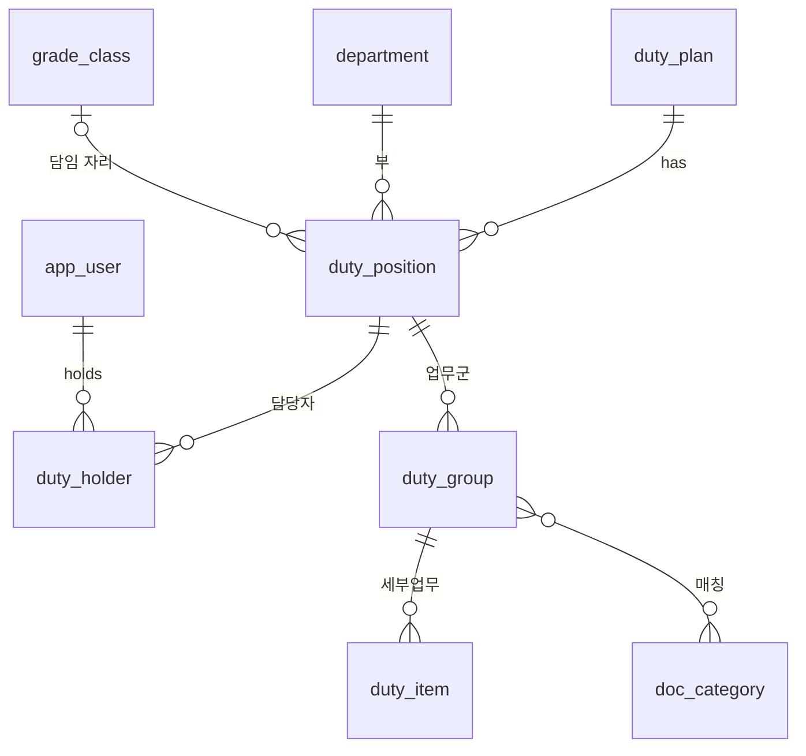

# 업무분장표 구조와 시스템 반영안 (v0.1 초안)

> 작성일 2026-11-24
> 근거 자료: 「2027학년도 교무업무분장 준비(안) 1차 – 2026 업무 돌아보기」(한글 hwpx, 교무업무 지원팀 배포)
> 관련 문서: [기능 명세서](./functional-spec.md) §7.3·§8.6, [DB 설계](./db-design.md) §4.1·§4.12
>
> 이 문서에는 **구조만** 적는다. 실제 교사 이름은 저장소에 넣지 않는다(예시는 `김○○`).

## 1. 원본 자료 요약

### 1.1 이 문서가 무엇인가
- 2027학년도 업무분장을 짜기 전에, 2026학년도 업무분장표를 교사에게 돌려 **각자 맡은 업무를 돌아보게 하는 설문지**다.
- 교사는 자기 행에 두 가지를 표시해 **메신저로 회신**한다(파일명: 교사명).
  - ① 세부업무에 없는데 실제로 주요하게 한 일 → **파란색으로 추가**
  - ② 세부업무에 있는데 실제로 하지 않은 일 → **빨간색으로 표시**
- 즉 지금은 "한글 파일 배포 → 교사 수십 명이 색칠 → 메신저로 회신 → 담당자가 다시 합치기"를 사람이 한다. 이 프로젝트가 줄이려는 바로 그 메신저 업무다(§5).

### 1.2 표의 구조
표는 3개(팀별)이고 열은 모두 같다.

| 열 | 뜻 | 예 |
|---|---|---|
| 부 | 부서 | 교무기획부, 1학년부 |
| 계 | 부서 안의 자리(직책) | 부장, 교무학사1, 평가, 1-3담임 |
| 담당자 | 그 자리를 맡은 교사 1명 | 김○○ |
| 업무군 | 그 자리가 맡은 업무 묶음 | 부서총괄, 인사관련, 공문처리, 학년 출결 |
| 세부업무 | 업무군 안의 구체 업무(글머리표 한 줄 = 1건) | 정규시간표 작성 및 운영, 결·보강관리 및 처리 |

- 셀 병합으로 위계를 표현한다: **부 ⊃ 계(담당자 1명) ⊃ 업무군 여러 개 ⊃ 세부업무 여러 줄**.
- 세부업무 칸은 문단마다 글머리표 기호(U+F09F)가 붙어 있어 **한 문단 = 세부업무 1건**으로 자르면 된다.

### 1.3 규모 (2026학년도 기준)

| 팀 | 부서 |
|---|---|
| 교무업무 지원팀 | 교무기획부, 교육연구부, 생활안전복지부, 교육과정운영부 |
| 교육활동지원팀 | 창의정보부, 방과후교육부, 학사운영부(기숙사), 국제인문사회부, 건강환경교육부, 진로특수교육부 |
| 학년경영팀 | 1·2·3학년부 (계 = 부장 + 1~9반 담임) |

- 팀 3, 부서 13, 계(자리) 63, 업무군 92, 세부업무 약 295건.
- 학교 규모 상한(교사 ≤100)과 비교하면 한 번에 화면 하나로 다룰 수 있는 크기다.

### 1.4 시스템 설계에 영향을 주는 특징

1. **3단 조직**: 팀 → 부 → 계. 현재 DB의 `department`는 부서 한 단계뿐이다.
2. **한 사람이 여러 자리**: 기숙사 사감이 동시에 3학년 담임, 건강 담당이 동시에 1학년 담임인 경우가 있다(2026년 표에서 4명). 담당자는 사람이 아니라 **자리(계)** 에 붙여야 한다.
3. **학년부의 계 = 담임 반**: "1-3담임 → 학년 출결", "2-5담임 → 학년 급식·생활평점제". 담임 배정과 학년 업무가 한 칸에 묶여 있다. 표 머리에 "담임 업무는 담임편성 완료 후 학년부장과 협의 편성"이라고 되어 있어, **담임 편성이 먼저, 학년 업무가 나중**이다.
4. **같은 업무가 범위를 나눠 여러 명에게**: 2학년 출결은 1~4반 담당, 5~9반 담당이 따로 있다. 업무에 **범위(학년, 반 구간)** 가 필요하다.
5. **같은 주제가 층위별로 여러 자리에**: 학교폭력(부장=총괄·사안처리, 교내1=사안처리 지원, 상담=관련 학생 상담), 학생맞춤통합지원(부장=기획, 교내2=실무), 출결(교내2=학교 전체, 학년 담임=학년 출결). 질문·공문을 누구에게 보낼지 정하려면 **층위(총괄/실무/지원)** 를 구분해야 한다.
6. **"부서에 속하는 기타업무"** 가 거의 모든 부장 칸에 있다. 매칭이 안 되는 공문의 **부서 기본 담당자 = 부장**으로 쓰면 된다.
7. **시스템 기능과 직접 맞닿는 자리**가 있다.
   - 교무학사3 "학교 공문 접수 및 담당자 지정 배분" → F-DOC의 **공문 배분 검토자**.
   - 교무학사1 "정규시간표 작성, 결·보강 관리" → **시간표 담당(`timetable_admin`)**.
   - 교무학사3·정보지원 "교사·학생·학부모 메시지 전송" → 이 시스템의 **전체 발송 담당**.
   - 창의정보부장 "나이스 운영(권한부여), 정보보안(개인정보)" → **시스템 관리자** 후보.
   - 생활안전복지부장·상담 → F-COUN **위기대응 수신자**(학생부장·상담교사).
   - 학년 출결 담당 → 출결 서류 제출처(담임 업무 문서 PR #3과 연결).

## 2. 데이터 구조 반영안

### 2.1 조직: `department`를 3단으로
- `department.kind`에 `team`(팀)을 추가하고 `parent_id`로 팀 → 부를 잇는다. 학년부는 `kind='grade'`, `grade` 값을 둔다.
- 팀·부서 이름은 해마다 바뀔 수 있으므로 **학년도별로 새로 만들지 않고** `is_active`로 관리하고, 업무분장(아래)만 학년도별로 둔다.

### 2.2 업무분장: 자리(계) → 업무군 → 세부업무
현재 `duty_assignment`(교사 1명 = 업무 이름 1개의 평평한 표)를 아래 4개 테이블로 바꾼다. 상세 컬럼은 [DB 설계 §4.12](./db-design.md).

| 테이블 | 원본의 무엇 | 핵심 컬럼 |
|---|---|---|
| `duty_plan` | 한 학년도의 업무분장표(판) | 학년도, 상태(`draft`/`review`/`final`), 확정일 |
| `duty_position` | 계(자리) | 부서, 자리 이름(부장·교무학사1·1-3담임), 담임 반(학년부만) |
| `duty_holder` | 담당자 | 자리 ↔ 교사, 시작·종료일(학기 중 교체 대비) |
| `duty_group` | 업무군 | 이름, 층위(`lead` 총괄 / `practice` 실무 / `support` 지원), 범위(학년·반 구간), 키워드 |
| `duty_item` | 세부업무 한 줄 | 문장, 순서, 돌아보기 표시(§2.3) |

- 담당자를 자리에 붙이므로 한 사람이 여러 자리를 맡아도, 학기 중 담당이 바뀌어도(휴직·전출) 업무 목록은 그대로 두고 `duty_holder`만 바꾸면 된다.
- 층위는 업무군 이름·문장에 "총괄, 기획"이 있으면 `lead`, "실무, 처리"면 `practice`, "지원"이면 `support`로 **가져올 때 자동 추정**하고 담당자가 고친다.
- 범위는 "(1반~4반)"처럼 괄호 안 반 구간을 가져올 때 자동 추출한다. 학년부 업무군은 해당 학년이 기본 범위다.

### 2.3 돌아보기(①파란색 추가 / ②빨간색 미수행)
- `duty_review` 테이블에 교사별 의견을 담는다: 어느 세부업무에 대해 `not_done`(하지 않음, 빨간색) / 어느 업무군에 `added`(추가로 한 일, 파란색) + 문장 + 메모.
- 다음 학년도 표를 만들 때 `added`는 새 세부업무 후보로, `not_done`은 삭제 후보로 담당자 화면에 모아 보여준다.

### 2.4 기존 테이블과의 연결
- **공문 담당자 추천(F-DOC §8.6)**: 공문의 업무 분류·키워드 → `duty_group.keywords`·`duty_item` 문장과 매칭(키워드 + 임베딩 유사도) → 해당 자리의 현재 담당자를 1·2순위로 추천. 같은 점수면 `practice`(실무)를 1순위, `lead`(총괄)를 2순위로. 매칭이 없으면 부서장(부서총괄).
- **질문 라우팅(F-QA §7.3)**: `topic_owner`의 "주제 → 부서" 매핑 대신 업무분장에서 바로 찾는다. 예: "3반 학생 체험학습 신청서 어디 내요?"(2학년) → 학년 출결 업무군 중 범위에 3반이 든 자리의 담당자. `topic_owner`는 업무분장에 없는 예외만 남긴다.
- **안내 대상(F-NOTI)**: 대상 유형에 `duty`(특정 업무군 담당자들, 예: "각 학년 출결 담당")를 추가한다.
- **역할(`user_role`)**: 시스템 권한(시간표 담당·공문 검토자·위기대응 수신자)은 업무분장과 별개로 관리자가 준다. 다만 업무분장 확정 시 "교무학사1 → 시간표 담당 권한 줄까요?"처럼 **제안**만 한다.

## 3. 가져오기 (hwpx 직접 + 엑셀)

학교는 업무분장표를 **한글(hwpx)** 로 만든다. 열린 질문 17에서 "엑셀로 작성"으로 정했지만, 실제 자료가 hwpx라 **hwpx 표를 직접 읽는 가져오기**를 함께 두는 편이 교사 부담이 적다.

### 3.1 hwpx 읽기 규칙
hwpx는 zip 안의 XML이라 별도 프로그램 없이 서버(Node)에서 읽을 수 있다. 실제 학교 서식을 다뤄 본 경험(교외체험학습 서식 작업 노트)에서 나온 주의점을 함께 반영했다.

- **본문 파일 찾기**: `Contents/content.hpf`의 `spine` 순서대로 `section0.xml`, `section1.xml`…을 모두 읽는다(구역이 나뉜 문서 대비). `Preview/PrvText.txt`는 앞부분만 담긴 미리보기라 쓰지 않는다.
- **한 줄짜리 거대 XML**: `section0.xml`은 줄바꿈 없이 수십만 자가 한 줄이다. 정규식으로 자르지 말고 XML 파서(스트리밍 가능한 것)로 읽는다.
- **표 → 격자**: `hp:tbl` → `hp:tr` → `hp:tc`. 칸 위치는 한 행의 칸 개수로 세지 말고 각 칸의 `hp:cellAddr`(`colAddr`, `rowAddr`)와 `hp:cellSpan`(`colSpan`, `rowSpan`)으로 격자에 놓는다. 병합된 부·계·담당자 칸은 `rowSpan`만큼 아래 행에 채운다. 첫 행(머리글 "부·계·담당자·업무군·세부업무")으로 열 순서를 확인한다.
- **칸 안 글자**: 한 문단(`hp:p`)의 글자는 여러 `hp:run` → `hp:t`로 쪼개져 있을 수 있으니 이어 붙인다. `hp:t` 안의 `hp:tab`·`hp:lineBreak`는 공백·줄바꿈으로 바꾼다. 줄 배치 정보(`hp:linesegarray`)는 읽을 때 무시한다.
- **메모(안내문) 제외**: 회색 안내 문구는 본문이 아니라 `hp:ctrl` 안 `hp:fieldBegin type="MEMO"` … `hp:fieldEnd`로 감싼 여백 메모다. 이 범위의 글자는 데이터에서 뺀다(넣으면 "1일 이상인 경우" 같은 안내문이 세부업무로 들어간다).
- **칸 안 표**: 칸 안에 또 표가 있으면(중첩 표) 바깥 표의 행으로 섞지 않고 그 칸의 글자로만 본다.
- **세부업무 나누기**: 세부업무 칸은 문단 하나 = 1건. 글머리표 기호(U+F09F)와 앞뒤 공백은 지운다. 빈 문단은 건너뛴다.
- **팀 이름**: 표 바로 앞 문단(예: "교무업무 지원팀", "학년경영팀 (* 담임 업무는…)")에서 괄호 앞까지를 팀 이름, 괄호 안은 팀 메모로 둔다.
- **글자 색(돌아보기)**: 각 `hp:run`의 `charPrIDRef` → `Contents/header.xml`의 `hh:charPr id=… textColor`로 색을 찾는다. 파란색(`#0000FF` 계열)은 `added`, 빨간색(`#FF0000` 계열)은 `not_done`으로 `duty_review`에 넣는다(교사가 한글 파일로 회신하는 동안의 호환용). 정확한 색값만이 아니라 "파랑/빨강에 가까운 색"으로 판정한다.
- **담당자 이름**: `app_user`와 이름으로 맞추고, 같은 이름이 둘 이상이거나 없으면 **확인 화면**에서 사람이 고른다. 원본 파일은 저장하지 않고 파일 이름만 `duty_plan.source_file`에 남긴다.
- **검증**: 가져온 뒤 "부 13 · 계 63 · 업무군 92 · 세부업무 295"처럼 개수를 보여 주고 원본과 같은지 사람이 확인한 다음 저장한다.

### 3.2 엑셀·기타 형식
- 엑셀 가져오기도 같은 5열(부·계·담당자·업무군·세부업무)을 기본 매핑으로 둔다. 세부업무는 셀 안 줄바꿈으로 구분.
- `.hwp`(옛 형식)는 바로 읽기 어려우므로 한글에서 hwpx나 엑셀로 저장해 올리도록 안내한다.

### 3.3 hwpx로 내보낼 때 주의 (나중 단계)
업무분장표나 돌아보기 결과를 다시 한글 파일로 내보낼 일이 생기면 아래를 지킨다. 읽기보다 쓰기가 훨씬 까다롭다.
- 원본 양식을 틀로 두고 글자만 바꾼다(처음부터 만들지 않는다).
- 다시 압축할 때 `mimetype`을 **첫 항목, 무압축**으로 넣고 나머지는 원본 순서대로.
- 여러 줄 문단의 글자를 바꾸면 `hp:linesegarray`를 새로 만든다. 남은 `hp:lineseg`의 `textpos`가 새 글자 수 이상이면 한글이 "문서가 손상되었습니다"라고 띄운다. 한글은 저장된 줄 나눔을 그대로 그리므로 줄 하나만 두면 글자가 한 줄에 겹쳐 찍힌다 → 칸 폭(`horzsize`)과 글자 폭(한글≈1, 숫자·공백≈0.5)으로 줄을 나눠 만든다.
- `treatAsChar="1"`(글자처럼 취급) 표는 다음 쪽으로 넘어가지 못한다. 여러 쪽이 될 표는 `treatAsChar="0"` + `pageBreak="CELL"`.
- XML 검사와 `unzip -t`를 통과해도 한글에서 깨질 수 있으므로 **한글에서 열어 확인**하는 단계가 꼭 필요하다. 운영 서버(맥미니)에는 한글 자동화(COM)가 없으므로, 확인은 사람이 하거나 한글이 설치된 Windows PC에서 한다.

## 4. 화면

1. **업무분장표 보기**: 원본과 같은 표 모양(팀 → 부 → 계 → 업무군 → 세부업무). 누구나 열람, "이 업무 담당이 누구지?"를 검색.
2. **내 업무**: 로그인한 교사가 맡은 자리·업무군·세부업무만. 각 줄에 "이번 학기 관련 공문 N건" 표시(공문 배정 기록과 연결).
3. **편집(교무기획부 업무분장 담당)**: 끌어서 세부업무 옮기기, 자리에 담당자 지정, 학년도 복사로 다음 해 초안 만들기.
4. **돌아보기 수합**: 아래 §5.

## 5. 돌아보기를 시스템으로 (메신저 회신 대체)

지금 방식(파일 배포 → 색칠 → 메신저 회신 → 수작업 합치기)을 이렇게 바꾼다.

1. 업무분장 담당이 "2026 돌아보기"를 연다 → 담당자가 있는 교사에게만 할 일(F-NOTI, `requires_completion`, 마감일)이 간다.
2. 교사는 **내 업무** 화면에서 줄마다 `안 함` 체크(빨간색), 업무군마다 `추가한 일` 입력(파란색). 파일 이름·색 맞추기가 필요 없다.
3. **시스템이 미리 채워 둔다**: 1년 동안 그 교사에게 배정된 공문·안내 중 어느 세부업무와도 맞지 않는 것은 "추가한 일 후보"로, 1년간 관련 공문이 0건인 세부업무는 "안 함 후보"로 보여준다. 교사는 확인만 한다(근거 공문 링크 함께).
4. 담당자 화면에서 미제출자, 부서별 추가·삭제 후보를 한눈에 보고, 다음 학년도 초안(`duty_plan` `draft`)에 반영한다.

## 6. 확인할 것 (사용자 결정 필요)

1. 업무분장표를 앞으로도 **한글(hwpx)** 로 만들 것인지, 시스템에서 바로 편집할 것인지? (제안: 2027학년도는 hwpx 가져오기 → 이후 시스템 편집)
2. 돌아보기를 2027학년도 준비(이번 겨울)부터 시스템으로 받을지, 이번에는 기존 방식으로 하고 결과 파일만 가져올지?
3. 정·부 담당(한 업무에 두 명)이 있는 학교도 있는데, 우리 학교 표는 자리당 1명이다. 자리당 여러 명을 허용해 둘지(제안: 허용하되 기본 1명).
4. 층위(총괄/실무/지원)를 공문 추천 순서에 쓰는 규칙(실무 1순위, 총괄 2순위)이 학교 관행과 맞는지?
