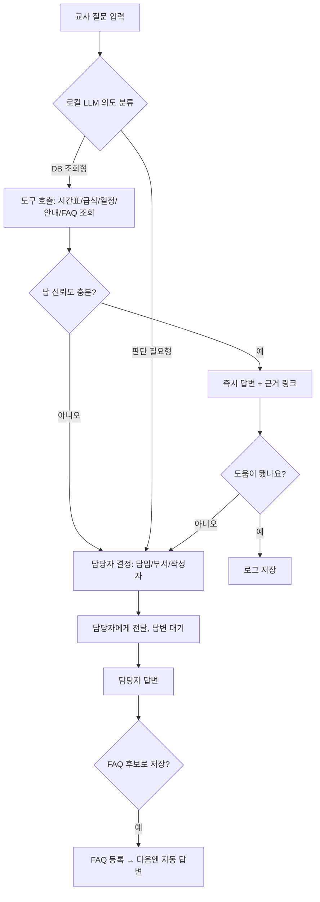
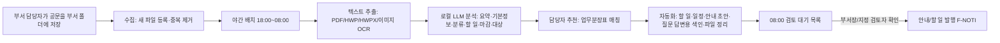

# 기능 명세서 (v0.1 초안)

> 학교 메신저 대체 시스템 — 작성일 2026-11-22
> 관련 문서: [DB 설계](./db-design.md)

## 1. 목적과 원칙

학교 메신저는 "누구에게나 뿌리는" 방식이라 담임교사가 하루 20~30건의 메시지를 확인하느라 시간을 허비한다. 이 시스템은 메시지 전달을 다음 두 가지로 바꾼다.

1. **필요한 사람에게만 가는 정보**: 모든 안내·할 일에는 대상(학년, 반, 부서, 담임 여부, 교과 등)이 붙고, 대상자에게만 표시·알림된다.
2. **스스로 찾는 정보**: 시간표, 급식, 학사일정, 제출 마감처럼 데이터로 저장된 정보는 메시지 대신 조회하거나 질문하면 즉시 답을 받는다.

설계 원칙

| 원칙 | 내용 |
|---|---|
| 데이터 우선 | 안내문을 글이 아니라 구조화된 데이터(대상·마감·카테고리)로 저장한다. |
| 자동 대상 분류 | 작성자가 "전체"로 보내도 시스템이 내용을 보고 필요한 사람에게만 가도록 나눈다. |
| 읽기보다 할 일 | 담임은 메시지 목록이 아니라 "내가 처리할 일" 목록을 본다. |
| 로컬 AI | AI(LLM)는 학교 내부 서버(Ollama)에서만 구동. 학교 데이터는 외부 API로 보내지 않는다. |
| 근거 제시 | 자동 답변에는 항상 근거(어느 데이터에서 왔는지)를 함께 표시한다. |
| 백업 필수 | DB는 매일 자동 백업, 복원 절차를 문서화·정기 점검한다. |

## 2. 사용자와 권한

| 역할 | 설명 | 주요 권한 |
|---|---|---|
| 시스템 관리자 | 정보부장/전산 담당 | 계정·권한 관리, 백업·복원, 시스템 설정 |
| 관리자(결재권자) | 교장, 교감 | 자동 분류 규칙 관리, 모든 안내·통계 열람 |
| 시간표 담당 | 교무부 시간표 담당자 | 시간표 편성·확정, 교체 승인 |
| 부서 담당자 | 각 부서 부장/계원 | 대상 지정 안내·할 일 발행, 소관 질문 응답 |
| 담임교사 | 학급 담임 | 학급 관련 할 일 처리, 학급 관련 질문 응답 |
| 위기대응 수신자 | 상담교사, 학생부장(직책명은 학교 설정), 교감, 교장 | 중요 사안 보고 수신, 사건 관리, 사유 기록 후 해당 상담 전문 열람 |
| 교사 | 모든 교사(담임 겸직 가능) | 안내 수신, 질문, 시간표 요청 제출, 교체 요청 |

- 한 사용자는 여러 역할을 가질 수 있다(예: 2학년 3반 담임 + 과학과 + 교무부 계원).
- 권한은 역할 기반(RBAC)으로 관리하고, 역할에는 범위(학년·반·부서)가 붙는다.
- **1단계(교내망, IP 접속) 로그인은 임시 로컬 계정**(2026-11-22 확정).
  - 아이디는 **선생님 한글 이름**. 같은 이름이 있으면 등록 순서대로 `홍길동`, `홍길동2`, `홍길동3`…으로 붙인다. 아이디는 한 번 정해지면 바뀌지 않는다(먼저 등록된 홍길동이 퇴직해도 홍길동2는 그대로).
  - 관리자가 엑셀 명단으로 일괄 등록하면 아이디가 자동 생성되고, 초기 비밀번호를 발급한다. 첫 로그인 때 비밀번호 변경을 강제한다.
  - 비밀번호를 잊으면 관리자가 재설정(감사 로그 기록).
  - 로그인 화면에서 같은 이름이 여럿이면 "홍길동2 = 과학과" 처럼 소속이 보이는 명단을 관리자 화면에서 확인할 수 있다.
- **2단계(도메인·HTTPS 준비 후) 로그인은 Google Workspace for Education 계정(교육청 발급 계정)으로 전환한다.** 기존 임시 계정에 Google 계정을 연결하는 방식이라 데이터는 그대로 이어진다. 연결 후에는 임시 비밀번호 로그인을 끈다.
- Google 로그인 상세: Google OAuth(OpenID Connect)로 인증하고, 허용 도메인(환경 변수)의 계정만 받는다. 처음 로그인한 교사는 관리자가 역할·부서를 지정하기 전까지 기본 `교사` 권한만 가진다. 자체 비밀번호는 두지 않는다.
- 1차 범위는 **교직원 전용**(2026-11-22 확정). 학생·학부모 조회는 이후 단계에서 검토.

## 3. 기능 목록 요약

| ID | 모듈 | 기능 | 우선순위 |
|---|---|---|---|
| F-AUTH | 계정 | Google Workspace for Education 로그인, 역할·범위 관리 | MVP |
| F-NOTI | 안내/할 일 | 대상 지정 안내, 전체 발송 자동 분류, 할 일(확인·완료), 마감 알림 | MVP |
| F-MEAL | 급식 | NEIS API 자동 수집, 알레르기 표시 | MVP |
| F-TT-VIEW | 시간표 | 기본 시간표 조회, 오늘의 내 시간표 | MVP |
| F-TT-SUB | 시간표 교체 | 교체 요청, 교체안 추천, 대상자 알림 | MVP |
| F-QA | 질문 라우팅 | 로컬 LLM 의도 분류, DB 자동 답변, 담당자 전달, FAQ 축적 | MVP |
| F-TT-GEN | 시간표 편성 | 교사 요구사항 수집, CP-SAT 솔버 자동 편성, 학점제 블록 연동 | 2단계 |
| F-CAL | 학사일정 | NEIS 학사일정 수집, 학교 자체 일정 | 2단계 |
| F-DOC | 공문 자동 처리 | 부서 폴더 공문 수집, 야간(18:00~08:00) 로컬 LLM 분석·업무 분류·담당자 추천·할 일/안내/일정 초안, 검토 후 발행 | MVP 이후 1순위 |
| F-COUN | 상담·민원 | 학생·학부모 상담 비공개 기록, 중요 사안 자동 판별·저장 시 고지·위기대응 수신자 보고, 민원 접수·배정 | MVP 이후 1순위 |
| F-DUTY | 업무분장 | 업무분장표 hwpx/엑셀 가져오기, 부·계·업무군·세부업무 조회와 "내 업무", 질문·공문 담당자 매칭의 기준, 연간 돌아보기 수합 ([업무분장 문서](./duty-assignment.md)) | MVP(가져오기·조회), 2단계(돌아보기) |
| F-EDTECH | 학습지원 SW 선정 | 「초·중등교육법」 제29조의2에 따른 학습지원 소프트웨어 수요조사·대상 판별·필수기준 확인(로컬 LLM 처리방침 분석 초안)·학운위 안건(서식1~4 hwpx) 생성·승인 목록 자동 답변 ([학습지원 SW 문서](./learning-software.md)) | A단계 2월 학운위 시험 운영(기존 방식 병행) → 3월 정식, B단계 2027 2학기 회차, C단계 이후 |
| F-ADMIN | 운영 | 백업·복원, 감사 로그, 통계 | MVP(백업), 2단계(통계) |

## 4. 안내 / 할 일 (F-NOTI)

메신저를 직접 대체하는 핵심 기능.

### 4.1 안내 작성
- 작성 항목: 제목, 본문, 카테고리(공지/할 일/제출/회의/행사), 대상, 마감일(선택), 첨부파일, 중요도.
- **대상 지정**: 다음 조건을 조합(AND/OR)한다.
  - 개인 지정
  - 학년, 반
  - 부서
  - 역할(담임, 부장, 교과 담당 등)
  - 교과
  - 저장된 그룹(예: "3학년 담임 + 진로부")
- 작성 중에 **예상 수신자 수와 명단을 미리보기**로 보여준다. 수신자 수가 많으면 "정말 이 사람들 모두에게 필요한가요?"라고 경고한다.
- **전체 발송 자동 분류**(2026-11-22 확정): 작성자가 대상을 "전체"로 두거나 대상을 고르지 않아도, 시스템이 **알아서 분류해 발송**한다. 승인 대기는 두지 않는다.
  1. 로컬 LLM이 제목·본문·첨부 파일명·카테고리·마감을 읽고 대상 규칙을 추론한다(예: "3학년 생기부 입력 마감" → 3학년 담임 + 3학년 교과 담당).
  2. 수신자마다 **관련도 등급**을 매긴다.
     - `해야 함`: 이 사람이 처리해야 하는 일 → 할 일 목록 + 즉시/마감 알림.
     - `참고`: 알아두면 좋은 정보 → 아침 요약 알림에만 포함, 할 일 목록에는 넣지 않음.
     - `해당 없음`: 보내지 않음(단, 안내 게시판 검색으로는 볼 수 있음).
  3. 작성자에게 분류 결과(등급별 인원·명단과 그렇게 분류한 이유)를 보여주고, 작성자는 그대로 보내거나 고쳐서 보낸다. 작성자가 일정 시간 안에 확인하지 않으면 분류 결과대로 발송하는 설정도 가능하다.
  4. 분류가 애매하면(신뢰도 낮음) 안전하게 `참고`로 넓게 보내고, 작성자에게 확인을 요청한다.
  5. 수신자는 "나와 관계없음"을 누를 수 있고, 이 피드백과 작성자의 수정 내역이 쌓여 다음 분류가 정확해진다(분류 예시로 사용).
- 관리자가 "필수 전체 공지"(예: 교장 공지, 비상 연락)로 지정한 안내는 분류 없이 전원에게 `해야 함`으로 간다.

### 4.2 할 일 처리
- 카테고리가 할 일/제출이면 수신자마다 개별 상태를 가진다: `미확인 → 확인 → 완료` (필요시 `해당없음`).
- 수신자 화면은 "메시지함"이 아니라 **마감순 할 일 목록**이 기본이다.
- 작성자는 대상자별 진행 현황(완료율, 미완료자 명단)을 보고, 미완료자에게만 재알림을 보낼 수 있다.
- 마감 D-1, 당일 아침 자동 알림(미완료자만).

### 4.3 알림 채널
- 집·휴대폰에서도 쓰므로 **모바일 우선 반응형 + PWA**(홈 화면 설치)로 만든다.
- **1단계(IP 접속)는 웹 푸시가 동작하지 않으므로 화면 내 알림(접속 시 배지·목록)만 쓴다.** 아침 요약은 첫 접속 시 화면에 띄운다. 2단계(HTTPS)부터 웹 푸시.
- **긴급·중요 사항 확인 화면**(2026-11-22 확정): 로그인했을 때 나에게 온 확인 안 한 긴급·중요 사항(중요 사안 보고, 긴급 안내, 필수 전체 공지)이 있으면 **나머지 화면을 블러 처리**하고 그 내용을 앞에 띄운다. **"확인했습니다"를 눌러야** 다른 화면으로 넘어갈 수 있고, 여러 건이면 한 건씩 차례로 확인한다. 확인 시각은 기록되어 보낸 사람·사건 담당자가 누가 확인했는지 볼 수 있다. 로그인 중에 새로 도착해도 같은 방식으로 뜬다.
- 웹 푸시(PWA) 기본(2단계). 하루 요약 알림(아침 1회)을 기본값으로 하고, 긴급만 즉시 알림.
- 사용자는 카테고리별로 알림 방식(즉시/요약/끔)을 설정할 수 있다. 단, 관리자가 "필수"로 지정한 안내는 끌 수 없다.

### 4.4 기타
- 안내는 검색 가능하며, 질문 라우팅(F-QA)의 근거 데이터로 쓰인다.
- 기존 안내를 "답장 전체"하는 기능은 두지 않는다. 질문은 작성자에게 1:1로 가고, 자주 나오는 질문은 작성자가 안내에 "추가 안내(Q&A)"로 붙여 모두에게 보이게 한다.

## 5. 급식 (F-MEAL)

- **NEIS 교육정보 개방 포털 API**(급식식단정보)를 하루 1회(새벽) 호출해 저장한다. 학교 코드·교육청 코드는 설정값.
- 저장 항목: 날짜, 식사 구분(조식/중식/석식), 메뉴, 알레르기 번호, 칼로리, 영양 정보.
- 메뉴명 뒤 알레르기 번호(예: `우유(2.5.6)`)를 파싱해 사람이 읽을 수 있는 이름으로 표시.
- 화면: 오늘/이번 주 급식. 질문 라우팅에서 "내일 급식 뭐야?" 같은 질문은 이 데이터로 즉시 답한다.
- API 장애 시 마지막 수집 성공 시각을 표시하고, 관리자가 수동 입력할 수 있다.

## 6. 시간표

### 6.1 시간표 조회 (F-TT-VIEW)
- 학급별, 교사별, 교실별 시간표.
- **오늘의 내 시간표**: 기본 시간표 + 당일 교체 사항을 반영한 실제 시간표. 교체된 칸은 강조 표시.
- 학점제 선택과목은 "블록(예: 선택A)"으로 표시하고, 펼치면 해당 시간에 개설된 과목·교사·교실 목록이 보인다.
- 교시 시각(시정표)은 설정값이며, 단축수업 등 날짜별 시정 변경을 지원한다.

- **NEIS 시간표 참조**(2026-11-22 확정): NEIS 교육정보 개방 API의 고등학교 시간표(hisTimetable)를 매일 수집한다. 원본은 교내에서 편성·교체한 시간표이고, NEIS 시간표는 다음 용도로 쓴다.
  - **대조**: 교내 시간표(교체 반영)와 NEIS 등록 시간표가 다른 칸을 담당자에게 목록으로 보여준다(NEIS 입력 누락·오류 발견용).
  - **초기 자료**: 학기 초 교내 시간표가 없을 때 NEIS 시간표를 가져와 출발점으로 쓸 수 있다.
  - NEIS 시간표는 과목명·학급 단위만 있고 교사·교실 정보가 없으므로, 교사 매칭은 편제 데이터로 보완한다.

### 6.2 시간표 교체 (F-TT-SUB)
**흐름**
1. 교사가 결원(출장·연가·병가 등) 또는 교체를 요청한다: 날짜, 교시(또는 하루 전체), 사유.
2. 시스템(솔버)이 **교체안 후보를 3~5개 추천**한다. 각 안에는 영향을 받는 교사 수, 연강 발생 여부, 해당 교사 당일 수업 수, 추가 수업 누적 수(공평성) 등의 점수가 표시된다.
   - 교체 유형: 맞교환(서로 다른 날/교시 수업 교환), 보강(빈 시간 교사가 대신), 자습 감독.
3. **시간표 담당자 승인은 필수**(2026-11-22 확정). 교사 간 합의가 있어도 담당자가 승인해야 확정된다.
4. 승인되면 **영향받는 사람에게만** 알림이 간다: 대체 교사, 원래 교사, 해당 학급 담임, (교실이 바뀌면) 교실 관리 담당.
5. 교체 이력은 모두 남고, 교사별 보강 누적 횟수가 공평성 지표로 쓰인다.

- 교사는 다른 교사에게 직접 맞교환을 제안할 수 있고, 상대가 수락하면 담당자 승인 대기로 넘어간다. 승인 전에는 시간표와 알림에 반영되지 않는다.
- 교체 결과는 "오늘의 내 시간표"와 질문 라우팅에 즉시 반영된다.

### 6.3 시간표 자동 편성 (F-TT-GEN)

이 프로젝트에서 가장 어렵고 가치가 큰 기능. LLM이 아니라 **제약 최적화 솔버(Google OR-Tools CP-SAT)**로 푼다.

#### 6.3.1 입력 데이터
| 데이터 | 내용 |
|---|---|
| 시정 | 요일 수, 요일별 교시 수, 점심·창체 등 고정 칸 |
| 학급 | 학년, 반, 학급 교실 |
| 교사 | 담당 교과, 최대 주당 시수 |
| 교실 | 일반/특별실(과학실, 컴퓨터실, 체육관 등), 수용 인원 |
| 편제(수업 단위) | 어떤 반(또는 선택과목 분반)의 어떤 과목을 어떤 교사가 주 몇 시간, 어떤 교실 유형에서 가르치는지 |
| 학점제 선택과목 | 과목별 수강생 명단, 분반, 블록 배정 |
| 교사 요청 | 희망/불가 시간, 연강 선호 등 (아래 6.3.3) |
| 고정 배치 | 담당자가 미리 박아둔 칸(예: 창체, 동아리, 순회 교사 고정 시간) |

#### 6.3.2 절대 조건 (Hard constraints) — 반드시 지켜야 함
1. 교사는 한 시간에 한 수업만.
2. 학급은 한 시간에 한 수업만.
3. 교실은 한 시간에 한 수업만(특별실 포함).
4. 모든 수업 단위의 주당 시수 충족.
5. 고정 배치 칸 준수.
6. 교사의 "불가" 시간(출강, 겸임, 순회 등 행정적으로 불가능한 시간) 준수.
7. **학점제 선택과목 블록 연동**:
   - 같은 블록에 속한 과목들은 같은 시간에 동시 개설된다.
   - 한 학생이 수강하는 과목들은 서로 다른 블록에 있어야 한다(학생 단위 충돌 없음).
   - 블록이 차지하는 시간에는 해당 블록 대상 학급들의 다른 수업이 배치되지 않는다.
8. **같은 과목은 하루 최대 1시간.** 예외로 지정한 과목(블록타임 과목)만 하루 최대 2시간이며, 2시간이면 반드시 연속(연강) 배치.
9. **연강 필수 과목**(예: 과학탐구실험)은 2시간 연속으로 배치. 연강 필수 과목 목록은 담당자가 추가할 수 있다.
10. 요일별 교시 수를 넘는 칸에는 배치하지 않는다(월·화·목·금 7교시, 수 4교시).

> **학교 시간표 규칙 (2026-11-22 확정)**
> - 하루 7교시, 수요일만 4교시 → 학급당 주 최대 **32칸**.
> - 같은 과목 하루 최대 1시간이 원칙. 블록타임 과목은 예외로 하루 2시간(연속) 허용.
> - 연강 필수: 과학탐구실험(목록은 추가 가능).
> - 규칙은 과목 단위 설정(`max_daily_hours`, `consecutive_rule`)과 학교 설정으로 관리해 화면에서 바꿀 수 있게 한다.

#### 6.3.3 희망 조건 (Soft constraints) + 우선순위 가중치
교사 요청과 학교 운영 선호는 위반 시 **벌점**을 부과하고, 솔버는 전체 벌점 합을 최소화한다.

| 유형 | 예시 | 기본 가중치 예 |
|---|---|---|
| 요일·시간 회피 | "목요일 오후 비워주세요" | 요청 우선순위에 따름 |
| 요일·시간 희망 | "월요일 1교시는 하고 싶어요" | 〃 |
| 연강 | 3연강 이상 회피 / 2연강 선호 | 높음 |
| 공강 분산 | 하루 수업 0시간 또는 6시간 이상 회피 | 중간 |
| 수업 몰림 | 하루 수업 시수 상한/하한 | 중간 |
| 같은 과목 분산 | 같은 반 같은 과목이 연속된 날에 몰리지 않게 | 중간 |
| 담임 조건 | 담임은 1교시 또는 조회 직후 자기 반 수업 선호 | 학교 설정 |
| 이동 최소화 | 특별실 간 연속 이동 최소화 | 낮음 |

**우선순위 산정**
- 교사별 요청에 교사가 직접 순위(1순위, 2순위, 3순위…)를 매긴다. 교사 1인당 요청 개수·"강한 요청" 개수에 상한을 둬서 모두가 "필수"를 쓰는 것을 막는다.
- 최종 가중치 = `유형 기본 가중치 × 교사 순위 계수 × 사유 계수`
  - 사유 계수: 육아·건강·대학원 등 사유 범주별 계수(인사자문위원회 결정, 증빙 여부 체크).
  - 형평성 보정: 직전 학기 요청 반영률이 낮았던 교사에게 가산(선택 기능).
- **우선순위 정책은 인사자문위원회가 결정한다**(2026-11-22 확정). 사유 범주와 계수, 교사당 요청 상한, 형평성 보정 사용 여부가 대상이다.
  - 시간표 담당자가 위원회 의결 내용을 학기별 "우선순위 정책"으로 입력하고, 의결일·근거(회의록 첨부)를 함께 기록한다.
  - 교사 요청 수집 기간이 열리면 정책은 잠긴다. 바꾸려면 새 의결을 입력해야 하고, 변경 이력이 남는다.
  - 교사는 요청 화면에서 현재 정책(사유별 계수, 요청 상한)을 볼 수 있다.
  - 유형별 기본 가중치(연강, 공강 분산 등 기술적 값)는 시간표 담당자가 조정하고, 조정 내역은 기록된다.

#### 6.3.4 편성 흐름
1. 담당자가 학기 편제·학점제 블록·고정 칸을 입력(엑셀 가져오기 지원, §6.4).
2. 교사 요청 수집 기간을 열면 교사가 요청을 제출. 자연어로 써도 되며, **로컬 LLM이 이를 구조화된 조건으로 변환한 뒤 교사가 확인**한다("목요일 5~7교시 수업 회피, 2순위 — 맞나요?").
3. 담당자가 편성 실행 → 솔버가 제한 시간(예: 5~30분) 내에 해를 찾는다.
4. 결과 보고서:
   - 해가 없으면 **충돌 원인 진단**(어떤 절대 조건 조합이 불가능한지, 최소 완화 후보).
   - 해가 있으면 교사별 요청 반영 여부·반영률, 전체 벌점, 위반 목록.
5. 담당자가 일부 칸을 수동 고정하고 재실행(부분 재편성) 가능.
6. 여러 버전을 저장·비교하고, 하나를 **확정**하면 학기 기본 시간표가 된다.

#### 6.3.5 학점제 블록 편성 보조
- 학생 수강 신청 데이터를 바탕으로 **과목 → 블록 배정**을 먼저 제안한다(학생 충돌 최소화 + 블록별 교실·교사 수 제약). 이것도 CP-SAT 별도 모델.
- 블록 배정 확정 후 6.3.4 편성에 입력된다.

#### 6.3.6 규모 기준 (2026-11-22 확정)
| 항목 | 상한 |
|---|---|
| 학급 수 | 50 이하 |
| 교사 수 | 100 이하 |
| 학점제 블록 수 | 10 이하 |
| 선택과목 수 | 50 이하 |

- 대략 주당 수업 칸은 학급당 최대 32칸 × 50학급 ≈ 1,600개에, 선택과목 분반 수업이 더해지는 규모다. CP-SAT로 수 분~수십 분 안에 풀 수 있는 범위로 보지만, 실제로 확인해야 한다.
- **성능 검증**: 이 상한에 맞춘 가상 학교 데이터를 만들어 Mac mini에서 편성을 돌리고, 목표는 "10분 안에 절대 조건을 모두 만족하는 해, 30분 안에 개선된 해"로 한다. 솔버 개발 초기에 이 벤치마크부터 만든다.
- 솔버는 LLM과 메모리를 나눠 쓰므로 편성 실행 중에는 솔버 스레드 수·메모리 상한을 설정값으로 둔다.

#### 6.3.7 솔버 구성
- Python + OR-Tools 서비스(별도 Docker 컨테이너), Next.js 서버와 HTTP(JSON)로 통신.
- 편성 작업은 오래 걸리므로 **비동기 작업(job)**: 요청 → job id → 진행 상태 폴링/웹소켓 → 결과 저장.
- 교체 추천(6.2)도 같은 서비스의 가벼운 엔드포인트로 처리(수 초 이내).

### 6.4 엑셀 가져오기·내보내기 (2026-11-22 확정: 기존 자료는 엑셀)
- 가져오기 대상: 교사 명단·담당 교과, 학급·학생 명단, 편제(반·과목·교사·시수), 학점제 수강 신청, 기존 시간표.
- 학교에서 쓰던 엑셀 양식을 그대로 받을 수 있도록 **열 매핑 화면**(엑셀 열 → 시스템 항목)을 두고, 한 번 맞춘 매핑은 저장해 다음 학기에 재사용한다.
- 가져오기 전 **미리보기와 검증**: 없는 교사 이름, 시수 합계 불일치, 중복 행 등을 표시하고 고친 뒤 반영.
- 시스템 표준 양식(.xlsx) 내려받기도 제공한다.
- 내보내기: 학급별·교사별 시간표, 교체 기록, 요청 반영 보고서를 엑셀로.

## 7. 질문 라우팅 (F-QA)

"담임에게 물어야 하나, 바로 답을 받을 수 있나"를 시스템이 판단한다.

### 7.1 처리 흐름

### 7.2 의도 분류
| 분류 | 예시 | 처리 |
|---|---|---|
| 시간표 | "오늘 3교시 2-3반 누구 수업?", "내일 내 수업 몇 시간?" | 시간표+교체 데이터 조회 |
| 급식 | "내일 점심 뭐야?", "이번 주 땅콩 들어간 메뉴?" | 급식 데이터 |
| 일정 | "중간고사 언제?", "다음 주 행사?" | 학사일정 |
| 안내·마감 | "생기부 입력 마감 언제?", "이 서류 어디 내?" | 안내 데이터(검색) + FAQ |
| 판단 필요 | "우리 반 학생 조퇴 가능?", "출장 처리 어떻게 해야 해?" (규정 해석) | 담당자 전달 |
| 기타/잡담 | — | 안내 후 종료 |

- LLM은 **답을 지어내지 않는다**. DB 조회형은 반드시 도구(정해진 조회 함수) 결과만으로 답하고, 결과가 없으면 "데이터가 없습니다 → 담당자에게 물어볼까요?"로 넘어간다.
- 자유 서술 안내문 검색은 임베딩 검색(pgvector, 로컬 임베딩 모델)으로 RAG 구성. 답변에는 원문 안내 링크를 붙인다.
- 분류·답변 신뢰도가 임계값 미만이면 사람에게 넘긴다(임계값은 관리자 설정).

### 7.3 담당자 결정 규칙
- 질문 대상 데이터에 소유자가 있으면 그 사람(예: 특정 안내 → 작성자).
- 학급 관련(학생, 반 이름 언급)이면 → 해당 반 담임.
- 주제 카테고리 → **업무분장표**에서 그 주제를 맡은 업무군의 현재 담당자(범위가 있으면 질문한 학년·반이 범위에 드는 사람. 예: 2학년 3반 출결 → 2학년 1~4반 출결 담당). 업무분장에 없는 주제만 관리자 매핑표 사용([업무분장 문서](./duty-assignment.md) §2.4).
- 담당자가 지정 시간 내 응답하지 않으면 부서 내 다른 담당자에게 재전달(선택).

### 7.4 FAQ 축적
- 담당자가 답변할 때 "FAQ로 등록" 체크 → 질문·답변·유효기간·공개 범위 저장.
- 비슷한 질문이 반복되면(임베딩 유사도) 시스템이 담당자에게 FAQ 등록을 제안.
- FAQ에는 유효기간이 있어 학기가 바뀌면 재확인을 요청한다.

### 7.5 로컬 LLM 구성
- **하드웨어: Mac mini (통합 메모리 24GB)** (2026-11-22 확정).
- **Ollama는 Docker가 아니라 macOS에 직접 설치**한다. macOS의 Docker는 Apple GPU(Metal)를 쓰지 못해 컨테이너 안에서는 CPU로만 돌아 매우 느리기 때문이다. Docker 컨테이너는 `http://host.docker.internal:11434`(환경 변수 `OLLAMA_URL`)로 호출한다.
- 메모리 예산(24GB를 모든 서비스가 나눠 씀): macOS·기타 약 4GB, Docker VM(웹·DB·솔버·worker) 약 6~8GB, LLM+임베딩 약 10~12GB.
- 모델 권장: 한국어가 되는 **7~14B급 4비트 양자화 모델**(예: Qwen2.5 14B 또는 7B, EXAONE 3.5 7.8B — 라이선스 확인 후 선정). 의도 분류는 작은 모델로도 충분하므로 7~8B로 시작해 정확도를 보고 올린다. 임베딩은 다국어 모델(예: bge-m3, 1024차원).
- 응답 속도 목표(§11.4)를 7~8B 모델 기준으로 실측해 확정한다. 동시 질문이 몰리면 큐로 순서대로 처리한다.
- 역할: ① 의도 분류 ② 도구 호출 파라미터 추출 ③ 조회 결과를 자연어로 정리 ④ 시간표 요청 자연어 → 조건 변환.
- 모든 질문·분류 결과·답변·피드백을 로그로 남겨 정확도를 개선한다(개인정보 마스킹 정책 포함).

## 8. 공문 자동 처리 (F-DOC)

> 2026-11-22 추가. 서버(Mac mini)에 부서별 폴더를 두고 공문을 내려받아 두면, **업무시간 외(18:00~08:00)** 에 로컬 LLM이 공문을 읽고 업무 분류·담당자 지정·자동화 처리를 해서, 다음 날 아침 안내/할 일(F-NOTI)로 이어지게 한다. 공문 내용은 학교 밖으로 나가지 않는다.

### 8.1 전체 흐름

### 8.2 부서 폴더
- 서버에 부서별 폴더를 둔다: `공문/<부서명>/받은공문`(새 공문), `공문/<부서명>/처리완료/<연도>/<분류>`(처리 후 정리).
- 1단계(교내망)에서는 Mac mini의 파일 공유(SMB)로 부서별 공유 폴더를 열고, 부서원만 접근하게 권한을 건다. 이 폴더는 Docker `worker` 컨테이너에 읽기·쓰기로 연결(마운트)한다.
- 웹 화면에서 직접 올리기(드래그 앤 드롭)도 같은 폴더로 저장되게 한다.
- 새 파일은 바로 목록에 "대기"로 등록되고(파일 해시로 중복 제거), 무거운 분석은 야간에 한다. **긴급 공문**은 화면에서 "지금 처리"를 눌러 낮에도 즉시 처리할 수 있다(질문 응답보다 낮은 우선순위로).

### 8.3 야간 배치 (18:00~08:00)
- 18:00에 시작해 대기 공문을 순서대로 처리하고, 08:00 전에 끝내지 못한 것은 다음 날 밤으로 넘긴다(낮에는 LLM을 질문 응답에 양보).
- 시간표 편성 같은 다른 야간 작업과는 **하나의 작업 큐**로 순서를 정한다(동시에 돌리면 24GB 메모리가 부족할 수 있음). 기본 순서: 공문 처리 → 백업 → 시간표 편성.
- 처리량 예상: 7~8B 모델 기준 공문 1건당 1~3분 → 하룻밤 수백 건 처리 가능(실측 후 확정).
- 실패한 공문(텍스트 추출 실패, 암호 걸린 파일 등)은 "확인 필요"로 표시하고 다음 단계로 넘어간다.

### 8.4 텍스트 추출
| 형식 | 방법 |
|---|---|
| PDF(텍스트) | PDF 텍스트 추출 |
| PDF(스캔)·이미지 | OCR(한국어, 예: Tesseract kor) |
| HWP | HWP 텍스트 추출 도구(예: pyhwp `hwp5txt`) |
| HWPX | ZIP 안의 XML에서 본문 추출 |
| 첨부 압축파일 | 풀어서 각각 처리 |

- 추출 품질이 낮으면(글자 수 너무 적음, 깨진 글자 비율 높음) "확인 필요"로 표시.

### 8.5 로컬 LLM 분석
공문마다 다음을 뽑아 저장한다(결과는 정해진 JSON 형식으로 받아 검증).
- **기본정보**: 제목, 발신기관, 문서번호, 시행일자.
- **요약**: 3줄 요약 + "우리 학교가 해야 할 일" 목록.
- **업무 분류**: 학교가 정한 분류표(부서별 업무 분류, 예: 학적·출결·방과후·안전·연수…) 중 하나 이상.
- **할 일과 마감**: 제출 서류, 회신 기한, 행사·연수 일자. 날짜는 원문 근거 문장과 함께 저장.
- **대상**: 누가 알아야 하는지(전체, 특정 학년 담임, 특정 교과 등) → F-NOTI 자동 분류 규칙으로 변환.
- **처리 유형**: `참고만`(공람), `안내 필요`, `제출·회신 필요`, `행사·일정`.
- 각 항목에 신뢰도를 매기고, 기준보다 낮으면 검토자에게 강조 표시.

### 8.6 담당자 지정
- **업무분장표**(학년도별, 한글 hwpx 또는 엑셀로 가져오기)를 기준으로 한다. 구조는 부 → 계(자리) → 담당자 → 업무군 → 세부업무([업무분장 문서](./duty-assignment.md)).
- LLM이 뽑은 업무 분류·키워드를 업무군 키워드와 세부업무 문장에 매칭(키워드 + 임베딩 유사도)해 **담당자 1순위·2순위를 추천**하고, 근거가 된 세부업무 문장을 이유로 보여준다.
- 같은 주제가 여러 자리에 있으면 실무(`practice`) 담당을 1순위, 총괄(`lead`) 담당을 2순위로 한다. 어디에도 맞지 않으면 해당 부서 부장("부서에 속하는 기타업무").
- 과거에 같은 분류의 공문을 누가 처리했는지도 참고한다(검토자가 담당자를 바꾸면 그 기록이 다음 추천에 반영).
- 담당자는 검토자가 확정하기 전까지 "추천"일 뿐이다.

### 8.7 자동화 처리
분석이 끝난 공문마다 시스템이 **초안**을 만들어 둔다. 기본값은 모두 검토자 확인 후 반영.
1. **할 일 초안**: 담당자에게 "제출 서류 작성, 마감 12/5" 같은 할 일(F-NOTI, `requires_completion`).
2. **안내 초안**: 교사들이 알아야 하는 공문이면 요약을 담은 안내 초안 + 대상 자동 분류(§4.1). 원문 링크 첨부.
3. **일정 등록**: 행사·연수·마감일을 학사일정(F-CAL)에 초안으로.
4. **질문 답변 색인**: 공문 본문을 RAG 색인(`document_chunk`)에 넣어 "이 공문 마감 언제야?", "방과후 관련 공문 뭐 왔어?"에 자동 답변(근거로 공문 링크). 공문 열람 권한 범위 안에서만.
5. **파일 정리**: 원본을 `처리완료/<연도>/<분류>/<시행일>_<제목>.<확장자>`로 옮기고 이름을 정리.
6. **아침 요약**: 08:00에 부서장·검토자에게 "어젯밤 처리한 공문 N건(검토 필요 M건)" 요약.

- 자동화로 **학교 밖으로 무언가를 보내는 일(회신 공문 발송, 외부 시스템 제출 등)은 하지 않는다.** 회신 공문 초안 작성 정도는 이후 단계에서 검토(열린 질문 15).
- 신뢰도가 높고 유형이 `참고만`인 공문은 검토 없이 자동 발행하는 옵션을 부서별로 켤 수 있다(기본 끔).

### 8.8 검토 화면 (08:00~)
- 부서장 또는 부서에서 지정한 검토자가 공문별로: 요약·분류·담당자·할 일·안내 초안·대상을 한 화면에서 보고 **확인/수정/반려**.
- 확인하면 할 일·안내·일정이 실제로 발행되고 담당자에게 알림이 간다.
- 수정 내역은 모두 저장해 분류·추천 정확도 개선에 쓴다(예시로 프롬프트에 넣기).
- 통계: 부서별 공문 수, 자동 분류 정확도(검토자가 그대로 승인한 비율), 평균 처리 시간.

## 9. 상담·민원 (F-COUN)

> 2026-11-22 추가. **교사와 학생(학부모) 사이 상담 내용은 비공개가 원칙**이다. 단, 생명에 위해가 있거나 법적으로 신고·공개 의무가 있는 **중요 사안**은 정해진 사람(상담교사, 학생부장, 교감, 교장)에게 알림이 간다. 이때 작성 교사가 당황하지 않도록 **저장하는 순간 "중요 사안으로 판단되어 보고됩니다"라고 미리 알려준다.**

### 9.1 기록 종류
| 종류 | 작성자 | 기본 열람 범위 |
|---|---|---|
| 학생 상담 | 담임·교과·상담교사 등 상담한 교사 | **작성 교사만** |
| 학부모 상담 | 상담한 교사 | **작성 교사만** |
| 민원 | 접수한 교직원 | 접수자 + 배정된 담당자 + 교감(민원은 처리해야 하는 일이므로 비공개 상담과 다름) |

- 학생은 **학번으로만** 식별한다(이름 미저장 원칙, DB 설계 §4.2).
- 기록 항목: 상담 일시, 방법(대면·전화·온라인), 대상(학생/학부모/기타), 내용, 후속 조치 메모.
- 작성 교사는 특정 동료(예: 상담교사, 공동 담임)에게 **직접 공유**할 수 있다. 공유는 기록 단위로, 언제든 취소 가능.
- **시스템 관리자·교장·교감도 일반 상담 내용은 볼 수 없다.** 관리 화면에는 건수 같은 통계만 보인다.

### 9.2 중요 사안 판별
**대상 유형**(학교 설정으로 추가·수정 가능)
| 유형 | 근거 예시 |
|---|---|
| 자살·자해 위험 | 생명 위해 |
| 타인 위해·생명 위협 | 생명 위해 |
| 아동학대 의심 | 아동학대처벌법상 교직원 신고 의무 |
| 학교폭력 | 학교폭력예방법상 신고 의무 |
| 성폭력·성희롱 | 성폭력처벌법·청소년성보호법상 신고 의무 |
| 가정폭력 | 가정폭력처벌법상 신고 의무 |
| 교권 침해(민원) | 교원지위법상 보호 조치 |

> 법령상 정확한 신고 의무 범위와 신고처는 학교·교육청 지침으로 확정한다(열린 질문 23).

**판별 방법** — 저장 버튼을 누르면 서버에서 동기 처리(목표 5초 이내)
1. **로컬 LLM 판별**: 내용을 읽고 유형·근거 문장·신뢰도를 정해진 JSON으로 반환.
2. **키워드 규칙**(병행, 안전망): "죽고 싶", "자해", "때렸", "신고" 등 학교가 관리하는 표현 목록. LLM이 바쁘거나 시간 초과면 규칙 결과만으로 판단.
3. **교사 직접 표시**: 교사가 "중요 사안" 체크를 직접 할 수 있다.

**결과별 처리**
| 판별 결과 | 처리 |
|---|---|
| 중요 사안(신뢰도 높음, 또는 교사 직접 표시) | 저장 전 고지 화면 → 저장과 동시에 보고 |
| 애매함(신뢰도 중간) | "중요 사안일 수 있습니다. 보고할까요?"를 교사에게 묻는다. "아니오"를 고르면 이유를 한 줄 적게 하고 기록(선택이 기록에 남음) |
| 해당 없음 | 그대로 비공개 저장 |

- 상담 내용은 LLM 호출 후 어디에도 남기지 않는다(질문 로그·학습 예시에 넣지 않음). 판별 결과(유형·신뢰도)만 저장.

### 9.3 저장 시 고지 (교사가 당황하지 않게)
중요 사안으로 판단되면 저장 버튼을 누른 직후, 저장 전에 다음 화면을 띄운다.

> ⚠️ **이 상담 내용은 [자해 위험]으로 판단되어, 저장하면 상담교사·학생부장·교감·교장에게 보고됩니다.**
> - 보고에는 학생 학번, 사안 유형, 작성 교사, 판단 근거 요약만 들어가고, 상담 전문은 들어가지 않습니다.
> - 보고받은 분이 대응을 위해 전문을 열람하면, 누가 언제 열람했는지 선생님께 알려드립니다.
> - 판단이 틀렸다고 생각되면 의견을 함께 남겨주세요. 보고받은 분이 확인 후 "오탐"으로 종결할 수 있습니다.
> - 신고 의무가 있는 사안이면 해야 할 일(신고처·기한)을 다음 화면에서 안내합니다.
>
> [의견 남기고 저장·보고] [내용 다시 보기]

- "내용 다시 보기"로 돌아가 수정할 수는 있지만, **고지가 뜬 사실과 판별 결과는 기록에 남는다**(보고를 피하려 내용을 지우는 것을 막기 위해). 재저장 시 다시 판별한다.
- 고지 후 저장하면 교사 화면에 "보고됨" 배지와 사건 진행 상황이 보인다.

### 9.4 보고와 대응
- **수신자**: "위기대응 수신자" 역할에 연결된 사람. 기본은 상담교사(전문상담교사), 학생부장, 교감, 교장. **학생부장은 학교마다 직책명이 다르므로**(생활안전부장, 학생생활부장 등) 직책명과 사람을 설정 화면에서 지정한다. 유형별로 수신자를 다르게 할 수 있다(예: 학교폭력 → 학교폭력 책임교사 추가).
- **알림 내용**: 학번, 유형, 작성 교사, 판단 근거 요약, 작성 시각. 상담 전문 없음.
- **긴급 알림**: 1단계(IP 접속)에서는 **로그인 시 안내로 충분**(2026-11-22 확정). 수신자가 로그인하면 화면이 블러 처리되고 중요 사안 알림을 "확인했습니다"로 확인해야 넘어간다(§4.3). 확인 시각은 사건 기록에 남고, 작성 교사도 수신자 확인 여부를 볼 수 있다. 2단계(HTTPS)부터는 휴대폰 푸시를 함께 보낸다.
- **전문 열람**: 수신자는 대응을 위해 해당 기록의 전문을 열 수 있다. 열람할 때마다 사유 선택(대응·신고·사실 확인)을 요구하고 기록하며, 작성 교사에게 "OOO 선생님이 열람함"을 알린다.
- **사건 관리**: 보고되면 "사건"이 생기고 상태를 관리한다: `접수 → 대응 중 → (외부 신고 완료: 기관·일시·신고자) → 종결` 또는 `오탐 종결(사유)`.
  - 신고 의무 유형이면 체크리스트를 보여준다(예: 아동학대 → 아동보호전문기관/112 신고, 즉시). 실제 신고는 사람이 하고, 시스템은 신고 기록과 미완료 알림만 담당한다.
  - 사건 담당자(보통 상담교사 또는 학생부장)를 지정해 후속 상담·조치를 기록한다. 사건 기록은 수신자들끼리 공유되고, 작성 교사도 진행 상황을 볼 수 있다.
- **오탐 처리**: 수신자가 "오탐"으로 종결하면 기록은 다시 비공개로 돌아가고 수신자 열람 권한이 닫힌다. 오탐 사례는 내용 없이 유형·키워드만 집계해 규칙·프롬프트를 고치는 데 쓴다.

### 9.5 민원
- 접수: 접수자(누구나)가 민원인 구분(학부모·지역주민·기타), 접수 경로(전화·방문·온라인), 내용, 관련 학번(선택), 희망 회신 기한을 입력.
- 로컬 LLM이 민원 주제로 담당 부서·담당자를 추천(공문 담당자 추천과 같은 업무분장표 사용) → 교감이 배정 확정.
- 처리 상태: `접수 → 배정 → 처리 중 → 회신 완료 → 종결`. 기한 임박 알림.
- 민원에도 중요 사안 판별을 적용한다. 특히 **교사 대상 폭언·협박·반복 악성 민원은 교권 침해 유형**으로 교감·교장에게 알리고, 해당 교사를 민원인과 직접 응대하지 않도록 하는 보호 조치를 안내한다.

### 9.6 보안
- 상담·민원 내용은 **애플리케이션 단에서 암호화**해서 DB에 저장한다(기록마다 별도 키, 그 키를 서버 마스터 키로 다시 암호화). DB 백업 파일을 누가 가져가도 내용을 읽을 수 없다.
- 마스터 키는 DB·백업과 **따로** 보관한다(Mac mini 키체인 또는 별도 비밀 파일 + 오프라인 사본 1부를 교장실 금고 등). **마스터 키를 잃으면 상담 기록을 복구할 수 없다**는 점을 운영 절차서에 명시.
- 모든 열람·수정·공유·보고·내보내기를 감사 로그(`sensitive_access_log`)에 남기고, 작성 교사는 자기 기록의 열람 기록을 볼 수 있다.
- 상담 화면은 유휴 5분 후 자동 잠금, 화면 캡처 경고 문구, 엑셀 내보내기 불가(인쇄는 사건 담당자만, 기록됨).

## 10. 학사일정 (F-CAL, 2단계)
- NEIS 학사일정 API 자동 수집 + 학교 자체 일정(회의, 부서 행사) 입력.
- 일정에도 대상 지정 가능. 질문 라우팅의 근거 데이터.

## 10-1. 학습지원 소프트웨어 선정·심의 (F-EDTECH)

> 2026-11-24 추가. 정보부 담당 업무. 상세는 [학습지원 SW 문서](./learning-software.md).

- 「초·중등교육법」 제29조의2(’26.3.1. 시행)에 따라 정규 교과에서 쓰는 학습지원 SW(학생 개인정보 처리 또는 제조사 교과 콘텐츠 포함)는 교육부 기준 확인 + 학운위 심의 후에만 쓸 수 있다.
- 시스템이 하는 일: ① 교과 교사에게만 수요조사 할 일(작년 목록 "계속 사용" 한 번에), ② 가이드 기준대로 심의 대상 자동 판별, ③ 개인정보처리방침을 읽어 로컬 LLM이 필수기준 9문항 초안 + 근거 문장(원문 대조 검증) 작성, 담당자 확정, ④ [서식1~4] hwpx 자동 생성(서명란 비움), ⑤ 승인 목록을 F-QA로 즉시 답변, ⑥ 처리방침 변경 감시·수시 신청 대기열.
- 외부로 보내는 것은 없다(처리방침 공개 페이지 읽기만). 업체 요청서 발송·안건 결재는 담당자가 기존 방식으로.
- 선정 회차·판정·증빙·심의 결과는 월간 정리 대상에서 제외(§11.5).

## 11. 운영·비기능 요구사항

### 11.1 백업 (필수)
- PostgreSQL: 매일 자동 `pg_dump`(새벽), **7일치 일간 + 4주치 주간 + 3개월치 월간 보관(최대 약 90일)**. 저장 공간 절약 원칙(§11.5)에 맞춰 월간 보관을 12개월에서 3개월로 줄였다.
- 업로드 파일(첨부)과 **아직 처리 중인** 공문 폴더는 같은 주기로 백업. 처리가 끝난 공문 원본은 K-에듀파인에 원본이 있으므로 백업하지 않는다.
- 정리(§11.5)로 지운 파일은 백업 보관 기간(최대 90일)이 지나면 백업에서도 사라진다. 그 사이에 실수로 지운 것은 백업에서 되살릴 수 있다.
- 백업은 **학교 NAS**에 복사한다(2026-11-22 확정). Mac mini 내부 백업 + NAS 사본으로 2곳 보관.
  - NAS는 전용 계정·전용 공유 폴더로 접근하고, 백업 파일은 암호화해서 저장(학생 개인정보 포함).
  - 가능하면 NAS를 서버와 다른 공간(다른 교실·건물)에 둔다. 화재·도난처럼 한 공간 전체가 피해를 입는 경우에 대비하려면, 월 1회 외장 디스크 등으로 학교 밖 보관본을 추가하는 것을 권장(3-2-1 원칙).
- 월 1회 복원 리허설(별도 컨테이너에 복원해 무결성 확인), 결과 기록.
- 백업 실패 시 시스템 관리자에게 알림.

### 11.2 보안·개인정보
- **단계적 공개**(2026-11-22 확정):
  - **1단계(초기)**: 교내망에서만 접속. 외부 공개 없음.
  - **2단계(추후)**: 집·휴대폰 외부 접속 공개(아래 방식, 열린 질문 13).
- **1단계에서도 HTTPS가 필요하다.** Google 로그인(OAuth)은 IP 주소를 돌아올 주소로 쓸 수 없고, 웹 푸시 알림·PWA 설치도 HTTPS에서만 동작하기 때문이다. 그래서 1단계 권장 방식은 **도메인을 먼저 준비하고, 그 도메인이 교내 IP를 가리키게 한 뒤 Let's Encrypt 인증서(DNS 인증)를 받는 것**이다. 외부에는 아무것도 열리지 않지만 교내에서는 `https://도메인`으로 접속되고, 2단계 공개 때 주소가 바뀌지 않는다.
  - 도메인 없이 `http://IP주소`로만 연결하면 Google 로그인·푸시 알림을 쓸 수 없어, 그동안은 임시 로컬 계정과 화면 내 알림만으로 운영해야 한다.
- 최종 목표는 **교내·집·휴대폰 어디서나 접속**. 인터넷에 공개되는 것은 웹(Next.js) 하나뿐이고, HTTPS 리버스 프록시(예: Caddy, 인증서 자동 갱신)를 앞에 둔다. 서버는 학교 안에 두고, 외부 공개는 터널 방식이 기본안이다(열린 질문 13).
- DB·LLM·솔버·worker는 Docker 내부 네트워크에만 두고 외부 포트를 열지 않는다.
- 로그인 시도·질문 API에 요청 속도 제한(rate limit), 보안 헤더 적용, 관리자 기능은 최근 재인증 요구.
- 학생 개인정보가 담긴 화면은 휴대폰 화면 잠금·자동 로그아웃(유휴 시간) 정책을 둔다.
- 인증은 Google 계정(OIDC)에 맡기고, 서버는 세션만 관리(만료 시간 설정). 2단계 인증은 Google Workspace 정책을 따른다.
- Google 로그인은 서버와 사용자 브라우저가 Google에 접속할 수 있어야 한다(외부 접속 운영이므로 충족).
- 로컬 계정 비밀번호는 argon2 해시로 저장하고, 로그인 실패 5회 시 잠금. 1단계는 http라 비밀번호가 암호화되지 않은 채 교내망을 오가므로, 교내망 전용으로만 쓰고 2단계 전환을 너무 늦추지 않는다.
- 2단계 이후에도 비상용 로컬 관리자 계정 1개(argon2 해시 비밀번호, 감사 로그 필수)를 둬서 Google 장애 시에도 시스템 관리·복원이 가능하게 한다.
- 공문은 개인정보가 들어 있을 수 있으므로 부서 폴더·공문 화면은 해당 부서원과 권한자만 열람. 공문 원문·분석 결과는 서버 밖으로 보내지 않는다.
- 감사 로그: 공문 열람·담당자 확정, 권한 변경, 전체 발송 분류 결과와 작성자 수정, 시간표 확정·교체, 백업·복원.
- 학생 개인정보는 최소 수집: **학번과 수강과목만 저장, 이름은 저장하지 않는다**(2026-11-22 확정). 화면에서도 학생은 학번으로 표시한다.

### 11.3 배포
- **서버: Mac mini 24GB 한 대가 모든 서비스를 실행**(2026-11-22 확정). Docker(웹·DB·솔버·worker·프록시) + macOS에 직접 설치한 Ollama.
- 단일 서버이므로 운영 조건:
  - 잠자기 끔, 정전 후 자동 켜짐, Docker Desktop·Ollama 로그인 시 자동 실행(macOS 자동 로그인 또는 launchd 서비스).
  - UPS(무정전 전원장치) 권장.
  - 서버 고장에 대비해 외부 백업(§11.1)과 "새 기기에 복원하는 절차서"를 함께 유지한다. Docker 구성 덕분에 다른 컴퓨터로 옮겨도 같은 방식으로 복원된다.
  - 시간표 편성(무거운 작업)은 솔버 CPU·메모리 상한을 두고, 가능하면 업무 시간 외에 돌리도록 안내한다. 편성 중에도 질문 자동 답변이 느려지지 않는지 실측한다.
- Docker Compose: `proxy`(Caddy, HTTPS), `web`(Next.js), `db`(PostgreSQL + pgvector), `solver`(Python OR-Tools), `worker`(정기 작업: NEIS 수집, 알림, 백업). Ollama는 Mac mini 호스트에서 직접 실행(§7.5).
- 다른 컴퓨터로 이전 가능하도록 모든 설정은 환경 변수·볼륨으로 분리.

### 11.4 성능 목표
- 일반 화면 응답 1초 이내, 자동 답변 5초 이내(로컬 LLM 포함), 교체 추천 10초 이내.
- 시간표 편성: 제한 시간 내 최선 해 반환(기본 10분).

### 11.5 데이터 보존·정리 (저장 공간 절약)
> 2026-11-22 확정: 필요 없는 자료는 **한 달 단위로 삭제**하고, **아직 처리되지 않은 일(기한이 남은 일)만 남긴다.**

- **정리 작업**: 매월 1일 야간 배치(§8.3 작업 큐, 공문 처리 다음)로 실행. 실행 전 날 관리자에게 "삭제 예정 목록(건수·용량)"을 화면에 보여주고, 관리자가 특정 항목을 "보존"으로 표시하면 제외한다.
- **남기는 것**: 마감이 지나지 않은 공문·안내·할 일, 미완료 할 일이 하나라도 연결된 공문·안내, "보존" 표시된 항목, 현재 학기 시간표·편제·업무분장, 계정·권한 정보.
- **지우는 대상과 기준**

| 대상 | 삭제 기준 | 지우는 것 | 남기는 것(작은 기록) |
|---|---|---|---|
| 공문 원본 파일 | 연결된 할 일이 모두 완료됐거나 마감이 지난 뒤 1개월 경과, `참고만` 공문은 처리 후 1개월 | 원본 파일, 추출 텍스트, 질문 답변용 색인 | 제목·발신기관·문서번호·시행일·담당자·처리 결과(수백 바이트). 원본은 K-에듀파인에서 다시 찾을 수 있음 |
| 안내 첨부파일 | 안내 마감(없으면 발행일) 후 1개월 경과 + 미완료 할 일 없음 | 첨부 파일 | 안내 본문·완료 현황 |
| 마감 지난 안내·할 일 | 마감 후 1개월 경과 + 모두 완료 | 수신자별 상태 상세 | 안내 본문·완료율 요약 |
| 질문 로그 | 1개월 경과 | 질문·답변 원문 | FAQ로 등록된 것은 유지, 분류 정확도 통계 |
| 알림 기록 | 1개월 경과 | 알림 행 | — |
| 급식·NEIS 시간표 수집본 | 1개월 경과 | 지난 데이터 | — |
| 교체 기록 | 학기 종료 후 1개월 | 칸별 상세 | 교사별 보강 누적 횟수(공평성 지표, 다음 학기에 사용) |
| 지난 학기 시간표 버전 | 학기 종료 후 1개월 | 확정본 외 초안 버전, 솔버 작업 입력 스냅샷 | 확정본 1개 |
| 감사 로그 | 1년 | 오래된 로그 | — (보안 기록이라 예외적으로 1년) |

- **학습지원 SW 선정 회차·판정·증빙·심의 결과(F-EDTECH)는 월간 정리 대상에서 제외**한다(법정 심의 근거).
- **상담·민원 기록과 중요 사안 사건 기록은 월간 정리 대상에서 제외**한다(법적·교육적 보존 필요). 보존 기간은 열린 질문 25에서 정한다.
- 삭제는 실제 파일 삭제 + DB 행 삭제(또는 요약만 남기고 상세 삭제)이며, 정리 결과(건수·확보한 용량)를 기록하고 관리자에게 알린다.
- 정리 후 DB 용량을 실제로 줄이도록 정기 `VACUUM`을 함께 실행한다.

## 12. 열린 질문 (결정 필요)

1. ~~**사용자 범위**~~ → **결정(2026-11-22): 1차는 교직원만.** 학생·학부모 조회는 이후 단계에서 검토.
2. ~~**로그인 방식**~~ → **결정(2026-11-22): Google Workspace for Education 계정(교육청 발급)으로 로그인.**
3. ~~**외부 접속**~~ → **결정(2026-11-22): 1단계는 교내망 전용, 추후 집·휴대폰 외부 공개.** 서버는 **학교 안**에 둔다. 남은 것: 외부에 여는 방법(아래 13번).
4. ~~**로컬 LLM 서버 사양**~~ → **결정(2026-11-22): Mac mini 24GB.** **Mac mini 한 대가 웹·DB·솔버·LLM을 모두 돌리는 단일 서버** (§11.3).
5. ~~**학교 규모**~~ → **결정(2026-11-22): 학급 50·교사 100·블록 10·선택과목 50 이하** (§6.3.6).
6. ~~**시간표 규칙**~~ → **결정(2026-11-22): 하루 7교시(수 4교시), 같은 과목 하루 1시간(블록타임 과목은 2시간 연속), 과학탐구실험 등 연강 필수(추가 가능)** (§6.3.2). 다른 고유 규칙이 생기면 이 목록에 추가.
7. ~~**교사 요청 우선순위 정책**~~ → **결정(2026-11-22): 인사자문위원회에서 결정** (§6.3.3). 실제 사유 범주·계수 값은 위원회 의결 후 입력.
8. ~~**교체 승인 권한**~~ → **결정(2026-11-22): 맞교환 포함 모든 교체는 시간표 담당자 승인 필수.**
9. ~~**전체 발송 기준**~~ → **결정(2026-11-22): 승인제 대신, 전체로 보내도 시스템이 내용을 보고 자동 분류해 발송** (§4.1). 남은 것: 작성자가 분류 결과를 확인하지 않아도 자동 발송할지, 한다면 몇 분 뒤에 할지.
10. ~~**기존 데이터 이관**~~ → **결정(2026-11-22): 엑셀** (§6.4). 남은 것: 실제 엑셀 양식 샘플(개인정보는 지운 것)을 받아 열 매핑 기본값 설계.
11. ~~**NEIS 연동 범위**~~ → **결정(2026-11-22): 급식·학사일정·시간표 모두 수집.** 시간표는 교내 편성본이 원본이고 NEIS는 대조·초기 자료용 (§6.1).
12. ~~**백업 보관 위치**~~ → **결정(2026-11-22): NAS** (§11.1). 남은 것: NAS 기종과 접속 방식(SMB/NFS/rsync), 서버와 같은 공간인지.
13. **외부 공개 방법** (2단계, 추후 — 1단계는 교내망 전용으로 확정. 서버는 학교 안): 학교망은 보통 외부→내부 접속(포트 개방)을 막으므로 **기본안은 터널 방식(Cloudflare Tunnel)**. 서버에서 바깥으로만 연결하므로 학교망 설정 변경이 필요 없다. 단, 암호화가 Cloudflare 구간에서 풀렸다 다시 걸리므로 개인정보 처리 관점에서 교육청·학교 정보보안 담당 확인이 필요하다. 대안: 학교망 포트 개방 허가(+ Caddy 인증서), 또는 Tailscale 같은 VPN(교사 휴대폰마다 앱 설치 필요). 정할 것: ① 정보보안 담당 확인 결과 ② 사용할 도메인 이름.
14. ~~**1단계 접속 주소**~~ → **결정(2026-11-22): 당분간 IP 주소(http)로만.** 임시 계정 아이디는 선생님 한글 이름(중복 시 홍길동, 홍길동2… 등록 순). 푸시 대신 화면 내 알림.
15. **공문 자동화 범위**: 1차는 할 일·안내·일정 초안, 질문 답변 색인, 파일 정리, 아침 요약까지(§8.7). 여기에 더할 자동화가 있는지(예: 회신 공문 초안, 제출 양식 자동 채우기)?
16. **공문 저장 경로**: 공문을 K-에듀파인(업무관리시스템)에서 각자 내려받아 부서 폴더에 저장하는 방식이 맞는지? 파일 형식 비율(HWP/HWPX/PDF)은?
17. ~~**업무분장표**~~ → **결정(2026-11-22): 엑셀로 작성.** → **샘플 반영(2026-11-24)**: 실제 학교 양식은 한글(hwpx) 5열 표(부·계·담당자·업무군·세부업무)라 hwpx 직접 가져오기도 지원([업무분장 문서](./duty-assignment.md) §3). 남은 것: 앞으로도 hwpx로 만들지, 연간 돌아보기를 시스템으로 받을지(같은 문서 §6).
18. **공문 검토자**: 부서장이 검토하는지, 부서마다 지정한 계원이 검토하는지? `참고만` 공문 자동 발행을 허용할지?
19. **공문 분류표**: 부서별 업무 분류 목록을 학교에서 정해 줄지, 첫 학기 공문으로 시스템이 초안을 만들어 제안할지?
20. **원본 보관**: 처리완료 공문 원본을 몇 년 보관할지, 기존에 쌓인 공문(과거 자료)도 한 번에 넣어 색인할지?
21. **보존 정책 예외**: 한 달 정리 대상 중 오래 남겨야 하는 자료가 있는지(예: 감사 로그 1년, 교체 누적 횟수, 생활기록부·성적 관련 공문)? 삭제 기준을 "마감 후 1개월"로 할지 "처리 완료 후 1개월"로 할지?
22. **위기대응 수신자**: 기본 수신자(상담교사·학생부장·교감·교장) 외에 유형별로 추가할 사람(학교폭력 책임교사, 보건교사 등)? 이 학교의 "학생부장" 직책명은?
23. **신고 의무 유형과 절차**: 중요 사안 유형 목록(§9.2)과 유형별 신고처·기한을 교육청 지침에 맞춰 확정. 키워드 목록은 누가 관리할지(상담교사 제안)?
24. ~~**1단계 긴급 알림**~~ → **결정(2026-11-22): 로그인 시 안내로 충분. 대신 긴급·중요 사항은 화면 블러 + "확인"을 눌러야 넘어가게** (§4.3).
25. **상담 기록 보존 기간**: 월간 정리에서 제외한다면 얼마나 보관할지(예: 학생 졸업 후 N년)? 오탐 종결 건의 판별 기록 보존 기간은?
26. **수신자 전문 열람**: 수신자가 사유를 남기고 전문을 바로 열 수 있게 할지, 작성 교사 동의 또는 교감 승인을 거치게 할지? (기본안: 사유 기록 후 바로 열람 + 작성 교사에게 알림)
27. **학습지원 SW 선정(F-EDTECH)**: (결정 2026-11-26: 2월 학운위는 시험 운영·기존 방식 병행, 3월 정식) 남은 것: 재심의 주기, 학운위 개최 시기, 서버가 업체 처리방침 공개 페이지를 읽어도 되는지 ([학습지원 SW 문서](./learning-software.md) §14).
