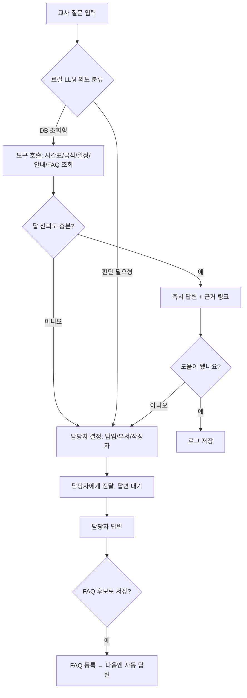

# 기능 명세서 (v0.1 초안)

> 학교 메신저 대체 시스템 — 작성일 2026-11-22
> 관련 문서: [DB 설계](./db-design.md)

## 1. 목적과 원칙

학교 메신저는 "누구에게나 뿌리는" 방식이라 담임교사가 하루 20~30건의 메시지를 확인하느라 시간을 허비한다. 이 시스템은 메시지 전달을 다음 두 가지로 바꾼다.

1. **필요한 사람에게만 가는 정보**: 모든 안내·할 일에는 대상(학년, 반, 부서, 담임 여부, 교과 등)이 붙고, 대상자에게만 표시·알림된다.
2. **스스로 찾는 정보**: 시간표, 급식, 학사일정, 제출 마감처럼 데이터로 저장된 정보는 메시지 대신 조회하거나 질문하면 즉시 답을 받는다.

설계 원칙

| 원칙 | 내용 |
|---|---|
| 데이터 우선 | 안내문을 글이 아니라 구조화된 데이터(대상·마감·카테고리)로 저장한다. |
| 기본은 대상 지정 | 전체 발송은 관리자 승인이 있어야 한다. |
| 읽기보다 할 일 | 담임은 메시지 목록이 아니라 "내가 처리할 일" 목록을 본다. |
| 로컬 AI | AI(LLM)는 학교 내부 서버(Ollama)에서만 구동. 학교 데이터는 외부 API로 보내지 않는다. |
| 근거 제시 | 자동 답변에는 항상 근거(어느 데이터에서 왔는지)를 함께 표시한다. |
| 백업 필수 | DB는 매일 자동 백업, 복원 절차를 문서화·정기 점검한다. |

## 2. 사용자와 권한

| 역할 | 설명 | 주요 권한 |
|---|---|---|
| 시스템 관리자 | 정보부장/전산 담당 | 계정·권한 관리, 백업·복원, 시스템 설정 |
| 관리자(결재권자) | 교장, 교감 | 전체 발송 승인, 모든 안내·통계 열람 |
| 시간표 담당 | 교무부 시간표 담당자 | 시간표 편성·확정, 교체 승인 |
| 부서 담당자 | 각 부서 부장/계원 | 대상 지정 안내·할 일 발행, 소관 질문 응답 |
| 담임교사 | 학급 담임 | 학급 관련 할 일 처리, 학급 관련 질문 응답 |
| 교사 | 모든 교사(담임 겸직 가능) | 안내 수신, 질문, 시간표 요청 제출, 교체 요청 |

- 한 사용자는 여러 역할을 가질 수 있다(예: 2학년 3반 담임 + 과학과 + 교무부 계원).
- 권한은 역할 기반(RBAC)으로 관리하고, 역할에는 범위(학년·반·부서)가 붙는다.
- **로그인은 Google Workspace for Education 계정(교육청 발급 계정)으로 한다**(2026-11-22 확정). Google OAuth(OpenID Connect)로 인증하고, 허용 도메인(환경 변수)의 계정만 받는다. 처음 로그인한 교사는 관리자가 역할·부서를 지정하기 전까지 기본 `교사` 권한만 가진다. 자체 비밀번호는 두지 않는다.
- 1차 범위는 **교직원 전용**(2026-11-22 확정). 학생·학부모 조회는 이후 단계에서 검토.

## 3. 기능 목록 요약

| ID | 모듈 | 기능 | 우선순위 |
|---|---|---|---|
| F-AUTH | 계정 | Google Workspace for Education 로그인, 역할·범위 관리 | MVP |
| F-NOTI | 안내/할 일 | 대상 지정 안내, 할 일(확인·완료), 마감 알림, 전체 발송 승인 | MVP |
| F-MEAL | 급식 | NEIS API 자동 수집, 알레르기 표시 | MVP |
| F-TT-VIEW | 시간표 | 기본 시간표 조회, 오늘의 내 시간표 | MVP |
| F-TT-SUB | 시간표 교체 | 교체 요청, 교체안 추천, 대상자 알림 | MVP |
| F-QA | 질문 라우팅 | 로컬 LLM 의도 분류, DB 자동 답변, 담당자 전달, FAQ 축적 | MVP |
| F-TT-GEN | 시간표 편성 | 교사 요구사항 수집, CP-SAT 솔버 자동 편성, 학점제 블록 연동 | 2단계 |
| F-CAL | 학사일정 | NEIS 학사일정 수집, 학교 자체 일정 | 2단계 |
| F-ADMIN | 운영 | 백업·복원, 감사 로그, 통계 | MVP(백업), 2단계(통계) |

## 4. 안내 / 할 일 (F-NOTI)

메신저를 직접 대체하는 핵심 기능.

### 4.1 안내 작성
- 작성 항목: 제목, 본문, 카테고리(공지/할 일/제출/회의/행사), 대상, 마감일(선택), 첨부파일, 중요도.
- **대상 지정**: 다음 조건을 조합(AND/OR)한다.
  - 개인 지정
  - 학년, 반
  - 부서
  - 역할(담임, 부장, 교과 담당 등)
  - 교과
  - 저장된 그룹(예: "3학년 담임 + 진로부")
- 작성 중에 **예상 수신자 수와 명단을 미리보기**로 보여준다. 수신자 수가 많으면 "정말 이 사람들 모두에게 필요한가요?"라고 경고한다.
- **전체 발송**(전 교직원 대상, 또는 수신자가 설정한 기준 인원 초과)은 관리자 승인 대기 상태가 되며, 승인 후 발송된다.

### 4.2 할 일 처리
- 카테고리가 할 일/제출이면 수신자마다 개별 상태를 가진다: `미확인 → 확인 → 완료` (필요시 `해당없음`).
- 수신자 화면은 "메시지함"이 아니라 **마감순 할 일 목록**이 기본이다.
- 작성자는 대상자별 진행 현황(완료율, 미완료자 명단)을 보고, 미완료자에게만 재알림을 보낼 수 있다.
- 마감 D-1, 당일 아침 자동 알림(미완료자만).

### 4.3 알림 채널
- 집·휴대폰에서도 쓰므로 **모바일 우선 반응형 + PWA**(홈 화면 설치)로 만든다.
- 웹 푸시(PWA) 기본. 하루 요약 알림(아침 1회)을 기본값으로 하고, 긴급만 즉시 알림.
- 사용자는 카테고리별로 알림 방식(즉시/요약/끔)을 설정할 수 있다. 단, 관리자가 "필수"로 지정한 안내는 끌 수 없다.

### 4.4 기타
- 안내는 검색 가능하며, 질문 라우팅(F-QA)의 근거 데이터로 쓰인다.
- 기존 안내를 "답장 전체"하는 기능은 두지 않는다. 질문은 작성자에게 1:1로 가고, 자주 나오는 질문은 작성자가 안내에 "추가 안내(Q&A)"로 붙여 모두에게 보이게 한다.

## 5. 급식 (F-MEAL)

- **NEIS 교육정보 개방 포털 API**(급식식단정보)를 하루 1회(새벽) 호출해 저장한다. 학교 코드·교육청 코드는 설정값.
- 저장 항목: 날짜, 식사 구분(조식/중식/석식), 메뉴, 알레르기 번호, 칼로리, 영양 정보.
- 메뉴명 뒤 알레르기 번호(예: `우유(2.5.6)`)를 파싱해 사람이 읽을 수 있는 이름으로 표시.
- 화면: 오늘/이번 주 급식. 질문 라우팅에서 "내일 급식 뭐야?" 같은 질문은 이 데이터로 즉시 답한다.
- API 장애 시 마지막 수집 성공 시각을 표시하고, 관리자가 수동 입력할 수 있다.

## 6. 시간표

### 6.1 시간표 조회 (F-TT-VIEW)
- 학급별, 교사별, 교실별 시간표.
- **오늘의 내 시간표**: 기본 시간표 + 당일 교체 사항을 반영한 실제 시간표. 교체된 칸은 강조 표시.
- 학점제 선택과목은 "블록(예: 선택A)"으로 표시하고, 펼치면 해당 시간에 개설된 과목·교사·교실 목록이 보인다.
- 교시 시각(시정표)은 설정값이며, 단축수업 등 날짜별 시정 변경을 지원한다.

### 6.2 시간표 교체 (F-TT-SUB)
**흐름**
1. 교사가 결원(출장·연가·병가 등) 또는 교체를 요청한다: 날짜, 교시(또는 하루 전체), 사유.
2. 시스템(솔버)이 **교체안 후보를 3~5개 추천**한다. 각 안에는 영향을 받는 교사 수, 연강 발생 여부, 해당 교사 당일 수업 수, 추가 수업 누적 수(공평성) 등의 점수가 표시된다.
   - 교체 유형: 맞교환(서로 다른 날/교시 수업 교환), 보강(빈 시간 교사가 대신), 자습 감독.
3. 시간표 담당자(또는 교사 간 합의 후 담당자)가 안을 승인한다.
4. 승인되면 **영향받는 사람에게만** 알림이 간다: 대체 교사, 원래 교사, 해당 학급 담임, (교실이 바뀌면) 교실 관리 담당.
5. 교체 이력은 모두 남고, 교사별 보강 누적 횟수가 공평성 지표로 쓰인다.

- 교사는 다른 교사에게 직접 맞교환을 제안할 수 있고, 상대가 수락하면 담당자 승인으로 넘어간다.
- 교체 결과는 "오늘의 내 시간표"와 질문 라우팅에 즉시 반영된다.

### 6.3 시간표 자동 편성 (F-TT-GEN)

이 프로젝트에서 가장 어렵고 가치가 큰 기능. LLM이 아니라 **제약 최적화 솔버(Google OR-Tools CP-SAT)**로 푼다.

#### 6.3.1 입력 데이터
| 데이터 | 내용 |
|---|---|
| 시정 | 요일 수, 요일별 교시 수, 점심·창체 등 고정 칸 |
| 학급 | 학년, 반, 학급 교실 |
| 교사 | 담당 교과, 최대 주당 시수 |
| 교실 | 일반/특별실(과학실, 컴퓨터실, 체육관 등), 수용 인원 |
| 편제(수업 단위) | 어떤 반(또는 선택과목 분반)의 어떤 과목을 어떤 교사가 주 몇 시간, 어떤 교실 유형에서 가르치는지 |
| 학점제 선택과목 | 과목별 수강생 명단, 분반, 블록 배정 |
| 교사 요청 | 희망/불가 시간, 연강 선호 등 (아래 6.3.3) |
| 고정 배치 | 담당자가 미리 박아둔 칸(예: 창체, 동아리, 순회 교사 고정 시간) |

#### 6.3.2 절대 조건 (Hard constraints) — 반드시 지켜야 함
1. 교사는 한 시간에 한 수업만.
2. 학급은 한 시간에 한 수업만.
3. 교실은 한 시간에 한 수업만(특별실 포함).
4. 모든 수업 단위의 주당 시수 충족.
5. 고정 배치 칸 준수.
6. 교사의 "불가" 시간(출강, 겸임, 순회 등 행정적으로 불가능한 시간) 준수.
7. **학점제 선택과목 블록 연동**:
   - 같은 블록에 속한 과목들은 같은 시간에 동시 개설된다.
   - 한 학생이 수강하는 과목들은 서로 다른 블록에 있어야 한다(학생 단위 충돌 없음).
   - 블록이 차지하는 시간에는 해당 블록 대상 학급들의 다른 수업이 배치되지 않는다.
8. 과목별 일일 최대 시수(예: 같은 과목 하루 2시간 초과 금지, 2시간이면 연속 배치 등 학교 규칙).

#### 6.3.3 희망 조건 (Soft constraints) + 우선순위 가중치
교사 요청과 학교 운영 선호는 위반 시 **벌점**을 부과하고, 솔버는 전체 벌점 합을 최소화한다.

| 유형 | 예시 | 기본 가중치 예 |
|---|---|---|
| 요일·시간 회피 | "목요일 오후 비워주세요" | 요청 우선순위에 따름 |
| 요일·시간 희망 | "월요일 1교시는 하고 싶어요" | 〃 |
| 연강 | 3연강 이상 회피 / 2연강 선호 | 높음 |
| 공강 분산 | 하루 수업 0시간 또는 6시간 이상 회피 | 중간 |
| 수업 몰림 | 하루 수업 시수 상한/하한 | 중간 |
| 같은 과목 분산 | 같은 반 같은 과목이 연속된 날에 몰리지 않게 | 중간 |
| 담임 조건 | 담임은 1교시 또는 조회 직후 자기 반 수업 선호 | 학교 설정 |
| 이동 최소화 | 특별실 간 연속 이동 최소화 | 낮음 |

**우선순위 산정**
- 교사별 요청에 교사가 직접 순위(1순위, 2순위, 3순위…)를 매긴다. 교사 1인당 요청 개수·"강한 요청" 개수에 상한을 둬서 모두가 "필수"를 쓰는 것을 막는다.
- 최종 가중치 = `유형 기본 가중치 × 교사 순위 계수 × 사유 계수`
  - 사유 계수: 육아·건강·대학원 등 학교가 정한 사유 범주별 계수(관리자 설정, 증빙 여부 체크).
  - 형평성 보정: 직전 학기 요청 반영률이 낮았던 교사에게 가산(선택 기능).
- 관리자는 가중치 표를 화면에서 조정할 수 있고, 조정 내역은 기록된다.

#### 6.3.4 편성 흐름
1. 담당자가 학기 편제·학점제 블록·고정 칸을 입력(엑셀 가져오기 지원).
2. 교사 요청 수집 기간을 열면 교사가 요청을 제출. 자연어로 써도 되며, **로컬 LLM이 이를 구조화된 조건으로 변환한 뒤 교사가 확인**한다("목요일 5~7교시 수업 회피, 2순위 — 맞나요?").
3. 담당자가 편성 실행 → 솔버가 제한 시간(예: 5~30분) 내에 해를 찾는다.
4. 결과 보고서:
   - 해가 없으면 **충돌 원인 진단**(어떤 절대 조건 조합이 불가능한지, 최소 완화 후보).
   - 해가 있으면 교사별 요청 반영 여부·반영률, 전체 벌점, 위반 목록.
5. 담당자가 일부 칸을 수동 고정하고 재실행(부분 재편성) 가능.
6. 여러 버전을 저장·비교하고, 하나를 **확정**하면 학기 기본 시간표가 된다.

#### 6.3.5 학점제 블록 편성 보조
- 학생 수강 신청 데이터를 바탕으로 **과목 → 블록 배정**을 먼저 제안한다(학생 충돌 최소화 + 블록별 교실·교사 수 제약). 이것도 CP-SAT 별도 모델.
- 블록 배정 확정 후 6.3.4 편성에 입력된다.

#### 6.3.6 규모 기준 (2026-11-22 확정)
| 항목 | 상한 |
|---|---|
| 학급 수 | 50 이하 |
| 교사 수 | 100 이하 |
| 학점제 블록 수 | 10 이하 |
| 선택과목 수 | 50 이하 |

- 대략 주당 수업 칸은 학급당 30~35시간 × 50학급 ≈ 1,500~1,750개에, 선택과목 분반 수업이 더해지는 규모다. CP-SAT로 수 분~수십 분 안에 풀 수 있는 범위로 보지만, 실제로 확인해야 한다.
- **성능 검증**: 이 상한에 맞춘 가상 학교 데이터를 만들어 Mac mini에서 편성을 돌리고, 목표는 "10분 안에 절대 조건을 모두 만족하는 해, 30분 안에 개선된 해"로 한다. 솔버 개발 초기에 이 벤치마크부터 만든다.
- 솔버는 LLM과 메모리를 나눠 쓰므로 편성 실행 중에는 솔버 스레드 수·메모리 상한을 설정값으로 둔다.

#### 6.3.7 솔버 구성
- Python + OR-Tools 서비스(별도 Docker 컨테이너), Next.js 서버와 HTTP(JSON)로 통신.
- 편성 작업은 오래 걸리므로 **비동기 작업(job)**: 요청 → job id → 진행 상태 폴링/웹소켓 → 결과 저장.
- 교체 추천(6.2)도 같은 서비스의 가벼운 엔드포인트로 처리(수 초 이내).

## 7. 질문 라우팅 (F-QA)

"담임에게 물어야 하나, 바로 답을 받을 수 있나"를 시스템이 판단한다.

### 7.1 처리 흐름

### 7.2 의도 분류
| 분류 | 예시 | 처리 |
|---|---|---|
| 시간표 | "오늘 3교시 2-3반 누구 수업?", "내일 내 수업 몇 시간?" | 시간표+교체 데이터 조회 |
| 급식 | "내일 점심 뭐야?", "이번 주 땅콩 들어간 메뉴?" | 급식 데이터 |
| 일정 | "중간고사 언제?", "다음 주 행사?" | 학사일정 |
| 안내·마감 | "생기부 입력 마감 언제?", "이 서류 어디 내?" | 안내 데이터(검색) + FAQ |
| 판단 필요 | "우리 반 학생 조퇴 가능?", "출장 처리 어떻게 해야 해?" (규정 해석) | 담당자 전달 |
| 기타/잡담 | — | 안내 후 종료 |

- LLM은 **답을 지어내지 않는다**. DB 조회형은 반드시 도구(정해진 조회 함수) 결과만으로 답하고, 결과가 없으면 "데이터가 없습니다 → 담당자에게 물어볼까요?"로 넘어간다.
- 자유 서술 안내문 검색은 임베딩 검색(pgvector, 로컬 임베딩 모델)으로 RAG 구성. 답변에는 원문 안내 링크를 붙인다.
- 분류·답변 신뢰도가 임계값 미만이면 사람에게 넘긴다(임계값은 관리자 설정).

### 7.3 담당자 결정 규칙
- 질문 대상 데이터에 소유자가 있으면 그 사람(예: 특정 안내 → 작성자).
- 학급 관련(학생, 반 이름 언급)이면 → 해당 반 담임.
- 주제 카테고리 → 부서 담당자 매핑표(관리자 설정, 예: 출결→교무부, 방과후→방과후부).
- 담당자가 지정 시간 내 응답하지 않으면 부서 내 다른 담당자에게 재전달(선택).

### 7.4 FAQ 축적
- 담당자가 답변할 때 "FAQ로 등록" 체크 → 질문·답변·유효기간·공개 범위 저장.
- 비슷한 질문이 반복되면(임베딩 유사도) 시스템이 담당자에게 FAQ 등록을 제안.
- FAQ에는 유효기간이 있어 학기가 바뀌면 재확인을 요청한다.

### 7.5 로컬 LLM 구성
- **하드웨어: Mac mini (통합 메모리 24GB)** (2026-11-22 확정).
- **Ollama는 Docker가 아니라 macOS에 직접 설치**한다. macOS의 Docker는 Apple GPU(Metal)를 쓰지 못해 컨테이너 안에서는 CPU로만 돌아 매우 느리기 때문이다. Docker 컨테이너는 `http://host.docker.internal:11434`(환경 변수 `OLLAMA_URL`)로 호출한다.
- 메모리 예산(24GB를 모든 서비스가 나눠 씀): macOS·기타 약 4GB, Docker VM(웹·DB·솔버·worker) 약 6~8GB, LLM+임베딩 약 10~12GB.
- 모델 권장: 한국어가 되는 **7~14B급 4비트 양자화 모델**(예: Qwen2.5 14B 또는 7B, EXAONE 3.5 7.8B — 라이선스 확인 후 선정). 의도 분류는 작은 모델로도 충분하므로 7~8B로 시작해 정확도를 보고 올린다. 임베딩은 다국어 모델(예: bge-m3, 1024차원).
- 응답 속도 목표(§9.4)를 7~8B 모델 기준으로 실측해 확정한다. 동시 질문이 몰리면 큐로 순서대로 처리한다.
- 역할: ① 의도 분류 ② 도구 호출 파라미터 추출 ③ 조회 결과를 자연어로 정리 ④ 시간표 요청 자연어 → 조건 변환.
- 모든 질문·분류 결과·답변·피드백을 로그로 남겨 정확도를 개선한다(개인정보 마스킹 정책 포함).

## 8. 학사일정 (F-CAL, 2단계)
- NEIS 학사일정 API 자동 수집 + 학교 자체 일정(회의, 부서 행사) 입력.
- 일정에도 대상 지정 가능. 질문 라우팅의 근거 데이터.

## 9. 운영·비기능 요구사항

### 9.1 백업 (필수)
- PostgreSQL: 매일 자동 `pg_dump`(새벽), 7일치 일간 + 4주치 주간 + 12개월치 월간 보관.
- 업로드 파일 저장소도 같은 주기로 백업.
- 백업은 **서버 외부 저장소**(NAS 또는 외장 디스크 등)에 복사(3-2-1 원칙 지향).
- 월 1회 복원 리허설(별도 컨테이너에 복원해 무결성 확인), 결과 기록.
- 백업 실패 시 시스템 관리자에게 알림.

### 9.2 보안·개인정보
- **교내·집·휴대폰 어디서나 접속**(2026-11-22 확정). 인터넷에 공개되는 것은 웹(Next.js) 하나뿐이고, HTTPS 리버스 프록시(예: Caddy, 인증서 자동 갱신)를 앞에 둔다.
- DB·LLM·솔버·worker는 Docker 내부 네트워크에만 두고 외부 포트를 열지 않는다.
- 로그인 시도·질문 API에 요청 속도 제한(rate limit), 보안 헤더 적용, 관리자 기능은 최근 재인증 요구.
- 학생 개인정보가 담긴 화면은 휴대폰 화면 잠금·자동 로그아웃(유휴 시간) 정책을 둔다.
- 인증은 Google 계정(OIDC)에 맡기고, 서버는 세션만 관리(만료 시간 설정). 2단계 인증은 Google Workspace 정책을 따른다.
- Google 로그인은 서버와 사용자 브라우저가 Google에 접속할 수 있어야 한다(외부 접속 운영이므로 충족).
- 비상용 로컬 관리자 계정 1개(argon2 해시 비밀번호, 감사 로그 필수)를 둬서 Google 장애 시에도 시스템 관리·복원이 가능하게 한다.
- 감사 로그: 로그인, 권한 변경, 전체 발송 승인, 시간표 확정·교체, 백업·복원.
- 학생 개인정보는 최소 수집(1차 범위에서는 학생 이름·학번·수강과목만).

### 9.3 배포
- **서버: Mac mini 24GB 한 대가 모든 서비스를 실행**(2026-11-22 확정). Docker(웹·DB·솔버·worker·프록시) + macOS에 직접 설치한 Ollama.
- 단일 서버이므로 운영 조건:
  - 잠자기 끔, 정전 후 자동 켜짐, Docker Desktop·Ollama 로그인 시 자동 실행(macOS 자동 로그인 또는 launchd 서비스).
  - UPS(무정전 전원장치) 권장.
  - 서버 고장에 대비해 외부 백업(§9.1)과 "새 기기에 복원하는 절차서"를 함께 유지한다. Docker 구성 덕분에 다른 컴퓨터로 옮겨도 같은 방식으로 복원된다.
  - 시간표 편성(무거운 작업)은 솔버 CPU·메모리 상한을 두고, 가능하면 업무 시간 외에 돌리도록 안내한다. 편성 중에도 질문 자동 답변이 느려지지 않는지 실측한다.
- Docker Compose: `proxy`(Caddy, HTTPS), `web`(Next.js), `db`(PostgreSQL + pgvector), `solver`(Python OR-Tools), `worker`(정기 작업: NEIS 수집, 알림, 백업). Ollama는 Mac mini 호스트에서 직접 실행(§7.5).
- 다른 컴퓨터로 이전 가능하도록 모든 설정은 환경 변수·볼륨으로 분리.

### 9.4 성능 목표
- 일반 화면 응답 1초 이내, 자동 답변 5초 이내(로컬 LLM 포함), 교체 추천 10초 이내.
- 시간표 편성: 제한 시간 내 최선 해 반환(기본 10분).

## 10. 열린 질문 (결정 필요)

1. ~~**사용자 범위**~~ → **결정(2026-11-22): 1차는 교직원만.** 학생·학부모 조회는 이후 단계에서 검토.
2. ~~**로그인 방식**~~ → **결정(2026-11-22): Google Workspace for Education 계정(교육청 발급)으로 로그인.**
3. ~~**외부 접속**~~ → **결정(2026-11-22): 집·휴대폰에서도 접속 가능.** 남은 것: 서버를 외부에 여는 방법(아래 13번).
4. ~~**로컬 LLM 서버 사양**~~ → **결정(2026-11-22): Mac mini 24GB.** **Mac mini 한 대가 웹·DB·솔버·LLM을 모두 돌리는 단일 서버** (§9.3).
5. ~~**학교 규모**~~ → **결정(2026-11-22): 학급 50·교사 100·블록 10·선택과목 50 이하** (§6.3.6).
6. **시간표 규칙**: 하루 교시 수, 같은 과목 하루 최대 시수, 연강 규칙 등 학교 고유 규칙 목록.
7. **교사 요청 우선순위 정책**: 사유 범주(육아·건강·대학원 등)와 계수, 교사당 요청 상한을 누가 정하는지(교무부 vs 인사자문위원회).
8. **교체 승인 권한**: 교사 간 맞교환을 담당자 승인 없이 바로 확정해도 되는지?
9. **전체 발송 기준**: 몇 명 이상을 "전체 발송"으로 보고 승인을 받게 할지?
10. **기존 데이터 이관**: 현재 시간표·편제·수강 신청 자료가 어떤 형식(엑셀, 나이스 내보내기, 시간표 프로그램 파일)인지?
11. **NEIS 연동 범위**: 급식·학사일정 외에 시간표 API(나이스 시간표)도 참조할지? (교내 편성 시간표가 원본이 되는 게 기본 가정)
12. **백업 보관 위치**: 외부 백업 저장소로 무엇을 쓸 수 있는지(NAS, 외장 디스크, 교육청 클라우드 등)?
13. **외부 공개 방법**: 서버를 학교에 둘 때 학교망에서 공인 IP·포트 개방이 허용되는지, 아니면 터널 방식(예: Cloudflare Tunnel)을 써야 하는지? 사용할 도메인 이름은?
