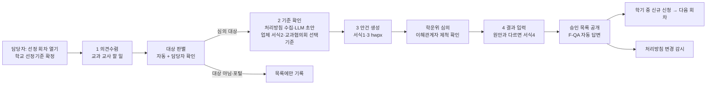
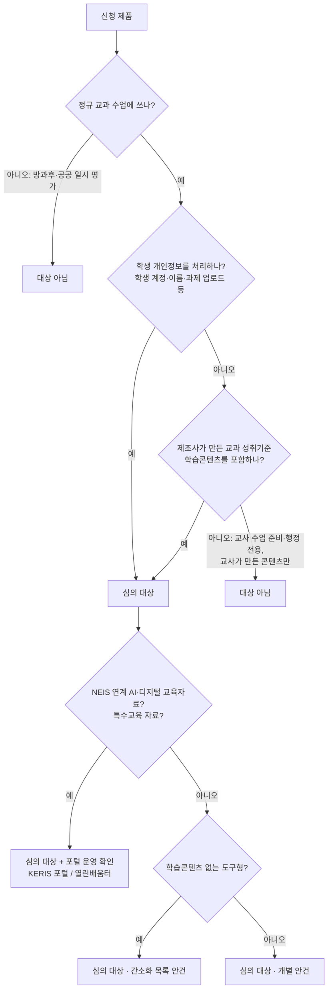

# 학습지원 소프트웨어 선정·심의 자동화 (F-EDTECH, v0.1 초안)

> 작성일 2026-11-24
> 근거 자료: 교육부 「학습지원 소프트웨어 선정 기준 및 가이드라인」(2025. 12., 한글 hwpx)
> 관련 문서: [기능 명세서](./functional-spec.md) §3·§10-1, [DB 설계](./db-design.md) §4.12-2, [업무분장](./duty-assignment.md)
>
> 이 문서에는 **절차와 구조만** 적는다. 교사·업체 담당자·학교운영위원 실명은 저장소에 넣지 않는다.

## 1. 왜 자동화가 필요한가

### 1.1 법적 근거와 지금 하는 일
- 「초·중등교육법」 제29조의2(’25.8.14. 신설, **’26.3.1. 시행**): 학교의 장이 **지능정보기술을 활용한 학습지원 소프트웨어**를 교육자료로 선정하려면 ① 교육부장관이 정한 기준(개인정보보호위원회 협의)을 따르고 ② **학교운영위원회 심의**(제32조제1항제4호 "교과용 도서와 교육 자료의 선정")를 거쳐야 한다.
- 학기 중에 새로 쓰고 싶은 SW도 **학운위 심의 후에만 사용**할 수 있다(가이드 Q11). 시기를 놓치면 다음 학운위까지 기다려야 한다.
- 업무분장상 정보부(창의정보부) 담당 업무다. 담당자는 해마다 새 학년 준비기간(2월)에 다음을 한다.

| 단계(가이드 Ⅲ) | 지금 방식 | 품이 드는 곳 |
|---|---|---|
| 1. 의견수렴 | 메신저로 "사용할 SW 알려 주세요" 전체 발송 → 회신 수합 | 회신 누락, 같은 제품 이름이 제각각(예: 띄어쓰기·영문), 대상 여부를 교사가 판단 못 함 |
| 2. 기준 충족 확인 | 제품마다 업체에 [서식2] 요청, 개인정보처리방침을 직접 읽고 [서식1] 체크 | 제품 수 × 필수 9문항. 증빙 찾기가 가장 오래 걸림 |
| 3. 안건 상정·심의 | [서식3] 안건을 한글로 작성, 이해관계자 확인 | 표 옮겨 적기, 오타 |
| 4. 확정 | 결과를 메신저로 다시 전체 발송 | "○○ 써도 돼요?" 질문이 학기 내내 옴 |

### 1.2 이 시스템이 바꾸는 것
1. **수요조사를 할 일로**: 교과 교사에게만 할 일이 가고, 작년 승인 목록에서 "계속 사용"을 고르면 끝난다(§3).
2. **대상 여부 자동 판별**: 질문 4~5개에 답하면 시스템이 심의 대상·대상 아님·포털 운영 대상을 가이드 기준대로 판정하고 근거를 보여준다(§4).
3. **필수기준 초안 자동 작성**: 서버가 제품의 개인정보처리방침을 읽고 로컬 LLM이 [서식1] 필수기준 9문항마다 **충족 여부 초안 + 근거 문장**을 채운다. 담당자는 확인만 한다(§5).
4. **서식 자동 생성**: [서식1] 체크리스트, [서식2] 업체 요청서, [서식3] 학운위 안건, [서식4] 심의 의견서를 학교 hwpx 양식에 채워 내려받는다(§7).
5. **승인 목록이 답이 된다**: 확정된 목록은 DB에 있으므로 "○○ 수업에 써도 돼?"는 질문 라우팅(F-QA)이 즉시 답한다. 결과를 메신저로 다시 뿌릴 필요가 없다(§8).
6. **사후 점검**: 개인정보처리방침이 바뀌면 알려 주고, 학기 중 신규 신청은 다음 학운위 안건으로 자동으로 쌓인다(§9).

## 2. 연간 흐름



- **선정 회차(`edtech_cycle`)** 단위로 일한다. 기본은 연 2회: **새 학년 준비(2월 학운위, 1학기·연간 사용분)**, **2학기 시작 전(7~8월 학운위)**. 학기 중 수시 학운위가 있으면 회차를 더 연다.
- 회차를 열 때 학운위 개최 예정일을 넣으면, 시스템이 거꾸로 일정을 잡는다(기본값, 학교가 수정 가능).

| 시점 | 할 일 | 자동화 |
|---|---|---|
| 학운위 D-30 | 수요조사 시작 | 교과 교사에게 할 일 발행(F-NOTI) |
| D-21 | 수요조사 마감 | 미제출자에게만 재알림, 마감 후 담당자에게 집계 |
| D-21 ~ D-10 | 기준 확인 | 야간 배치로 처리방침 수집·LLM 초안, 업체 요청서 생성 |
| D-10 | 교과협의회 선택기준 의견 마감 | 교과별 할 일 |
| D-7 | 안건 확정 | 서식1·3 생성, 학운위 간사(행정실) 전달용 파일 묶음 |
| 심의 후 3일 | 결과 입력 | 승인 목록 공개, 신청 교사에게 결과 알림 |

- 2027학년도 1학기분은 **2027년 2월 학운위**가 첫 대상이다. 회차를 1월 초에 열면 위 일정이 맞는다.

## 3. 1단계: 의견수렴 (수요조사)

### 3.1 할 일 발행
- 담당자가 "수요조사 시작"을 누르면 F-NOTI 할 일이 **정규 교과 수업을 하는 교사**에게만 간다(대상: `subject` 담당 교사 전체, 비교과·행정은 제외). 마감일 포함, `requires_completion`.
- 교사가 할 일을 열면 **작년(직전 회차) 승인 목록 중 본인이 신청했던 제품**이 먼저 보인다. "계속 사용 / 그만 씀"만 고르면 된다.
- 새 제품은 아래를 입력한다. 제품 이름을 치면 이미 등록된 제품(`edtech_product`)이 자동완성되어 **같은 제품이 이름만 다르게 여러 번 들어오지 않는다**.

| 입력 | 예 | 쓰임 |
|---|---|---|
| 제품명·공급자·접속 주소 | 다채움 / 충북교육청 / https://… | 제품 등록, 처리방침 찾기 |
| 사용 학년·교과·시기 | 1학년 수학, 1학기 | 안건 [서식3] 학년·관련 교과 |
| 쓰는 방식 | 수업 중 학생 사용 / 과제 제출 / 교사만 사용(수업 준비·행정) / 방과후 | 대상 판별 |
| 학생 계정·학생 정보 입력 | 학생이 가입·로그인, 이름·학번 입력, 과제·사진 업로드 등 | 대상 판별(개인정보 처리) |
| 제조사 제작 학습콘텐츠 | 교과 성취기준 문항·영상이 들어 있음 / 교사가 만든 것만 | 대상 판별(콘텐츠) |
| 선정이유(한두 줄) | 학생 수준별 맞춤 문항 제공 | 안건 선정이유 초안 |

- 같은 제품을 여러 교사가 신청하면 **제품 1건으로 합치고** 학년·교과·신청 교사를 모은다. 안건에서는 한 줄로 나온다.

### 3.2 수합 화면 (담당자)
- 제출률(교과별), 미제출 교사 목록(재알림 버튼), 제품별 신청 수.
- 메신저 회신을 엑셀로 합치던 일을 대신한다. 엑셀 내보내기도 지원.

## 4. 대상 판별

가이드 Ⅱ-1 적용대상과 자주 묻는 질문(Q1~Q6, Q12)을 규칙으로 옮겼다. 교사 입력(§3.1)으로 **자동 판정**하고, 담당자가 최종 확인한다.



판정 규칙의 세부(가이드 근거를 화면에 함께 표시):
- **공공 제작 SW**(교육부·교육청 제작, 예: 교육청 학습 플랫폼)도 정규 교과에 쓰고 학생 정보를 처리하면 대상(Q2·Q3). "공공이니 제외"로 판정하지 않는다.
- **해외 제품**도 같은 기준(Q5).
- **저작도구**: 같은 제품이라도 한 교사는 교사 전용, 다른 교사는 학생 과제 제출에 쓰면 학생 정보 처리가 생기므로 **신청 중 하나라도 학생 사용이면 대상**(Q4). 제품 단위로 판정을 합친다.
- **에듀테크 소프트랩 실증 제품**도 대상. 실증 결과는 기준 확인 참고자료로 첨부(Q7).
- **학교 홈페이지**, 교사 업무용 SW(학생 정보 없음)는 대상 아님(Q3, Ⅱ-1).
- **도구형**(학생 정보는 처리하지만 학습콘텐츠가 없음)은 [서식3]의 **간소화 목록**(제품명·충족여부·추천의견)으로 묶어 올린다(Q12). 학습콘텐츠가 있으면 개별 안건 표에 한 줄씩.
- 판정은 `대상(개별) / 대상(간소화) / 대상 아님 / 확인 필요`. 교사 답이 모순되면(예: 교사만 사용 + 학생 계정 있음) `확인 필요`로 담당자에게 넘긴다.
- **대상 아님으로 판정된 제품도 목록에 남긴다**(판정 근거와 함께). 나중에 감사·민원 때 "왜 심의를 안 했나"에 답할 수 있게.

## 5. 2단계: 기준 충족 확인

### 5.1 학교 선정기준 정하기
- 회차를 열 때 **학교 선정기준(`edtech_criteria_set`)** 을 정한다. 기본 틀은 가이드 그대로 들어 있다.
  - **필수기준 5개 영역 9문항(고정, 끌 수 없음)**: 1-1 최소 수집, 1-2 수집·이용 목적, 1-3 수집항목·보유기간, 2-1 안전성 확보 조치, 3-1 열람·정정·삭제·처리정지 절차, 4-1 만 14세 미만 법정대리인 동의, 5-1 보호책임자, 5-2 제3자 제공(필요시), 5-3 위·수탁(필요시).
  - **선택기준 5개(학교가 고름)**: 교육목표·학생 특성 적합성, 콘텐츠 품질·안전성, 사용 환경 적합성, 접근성·사용성, 서비스 운영·지원 체계.
  - **추가 예시 20개**([참고] 교육과정 연계성, 기기 호환성, 동시 접속 안정성, 장애학생 지원, 다국어 지원, 비용 정책 등)를 골라 넣거나 학교가 직접 문항을 쓸 수 있다.
- 작년 기준을 복사해 시작한다. 확정한 기준은 회차에 묶여 바뀌지 않는다(심의 근거 보존).

### 5.2 필수기준 판정 규칙
- 필수기준은 **모두 충족해야 사용 가능**. 하나라도 `미충족`이면 그 제품은 안건에서 "필수 미충족"으로 표시되고 추천 목록에서 빠진다.
- 학생 정보를 아예 수집하지 않는 등 문항이 맞지 않으면 `해당없음`은 허용(가이드 Ⅱ-3). 예: 만 14세 미만 학생이 없는 고등학교라도 4-1은 `해당없음` 처리 사유를 남긴다.
- 5-2·5-3은 "필요시" 문항이라 제3자 제공·위탁이 없으면 `해당없음`.
- 각 문항에는 **증빙(근거 문장·파일·링크)이 반드시 1개 이상** 있어야 `충족`으로 확정할 수 있다.

### 5.3 증빙 모으기 (세 갈래, 모두 자체 서버 안에서)

| 출처 | 방법 | 자동화 |
|---|---|---|
| ① 개인정보처리방침 | 제품 접속 주소에서 처리방침 페이지를 찾아(링크 글자 "개인정보처리방침/Privacy") 서버가 **읽기만** 한다. 주소를 직접 넣거나 PDF를 올려도 된다 | 야간 배치로 본문 저장(§5.4 LLM 분석의 재료) |
| ② 업체 회신 [서식2] | 시스템이 제품 개요를 채운 [서식2] 요청 파일(hwpx)을 만들어 준다. **보내는 것은 담당자가 직접**(메일·공문) | 회신 파일을 올리면 표를 읽어 문항별 체크·붙임을 가져옴 |
| ③ 에듀집(edzip.kr) 게시판 | 교육부가 업체 필수기준 준수 여부를 게시(’26.1월 말 개설). 담당자가 확인 후 링크·캡처를 증빙으로 첨부 | 제품별 "에듀집 확인함" 표시·날짜. 화면에서 에듀집 검색 링크 제공 |

- 서버가 바깥으로 하는 일은 **공개된 처리방침 페이지를 읽어 오는 것뿐**이다. 학교 자료(신청 교사, 학생 수 등)는 어디에도 보내지 않는다. 외부 API·클라우드 서비스는 쓰지 않는다.
- 학교망 정책으로 서버의 외부 접속이 막혀 있으면 ①은 담당자가 처리방침을 PDF로 저장해 올리는 방식으로 대신한다.

### 5.4 로컬 LLM 필수기준 초안
야간 배치(F-DOC과 같은 작업 큐, §8.3)에서 제품마다 실행한다.

1. 처리방침 본문을 항목 제목 단위로 자른다("1. 개인정보의 처리 목적", "개인정보의 안전성 확보 조치"…). 법정 기재 항목이라 제목 패턴이 비슷하다.
2. 문항마다 관련 항목을 찾고(키워드 + 임베딩), LLM에 문항과 해당 본문만 넣어 JSON으로 받는다.
   ```json
   {"criterion":"4-1","result":"met|not_met|na|unknown",
    "evidence":"원문에서 그대로 옮긴 문장","section":"항목 제목","confidence":0.0}
   ```
3. **근거 문장 검증**: `evidence`가 원문에 실제로 있는지 문자열로 대조한다. 없으면(LLM이 지어낸 문장) 결과를 버리고 `unknown`.
4. 규칙 검사를 함께 돌린다. 예: 1-3은 "보유기간/보존기간" 단어와 기간 표현이 없으면 `not_met` 후보, 4-1은 "14세 미만" "법정대리인"이 없으면 `unknown`, 5-1은 "개인정보 보호책임자" + 연락처 형식.
5. 결과는 모두 **초안**(`suggested_by='llm'`). 담당자가 문항마다 근거 문장을 보고 `확정`을 눌러야 반영된다. LLM이 `met`이라도 담당자가 확인하지 않으면 안건에 "확인 중"으로 나온다.

- 화면은 문항 9개를 한 줄씩: 초안 결과 · 근거 문장(원문 위치로 이동) · 업체 회신 결과 · 에듀집 확인 여부. 세 출처가 다르면 강조 표시.
- 고교라 학생 대부분이 만 14세 이상이어도, 처리방침 자체의 아동 보호 절차 기재 여부는 그대로 판정한다(학교가 `해당없음`으로 바꾸려면 사유 입력).

### 5.5 선택기준: 교과협의회 의견
- 선택기준은 학교 자율 판단이다. 제품을 신청한 교과의 교사들에게 **교과협의회 의견 할 일**이 간다(제품별, 학교가 고른 선택기준 문항만).
- 교사는 문항마다 충족·미충족·해당없음과 한 줄 의견. 시스템은 교과별로 모아 **다수 의견 + 소수 의견 요약**을 만든다(LLM, 원문 의견 함께 보존).
- 학교가 원하면 물품구매위원회 등 다른 협의체를 의견수렴 단위로 지정할 수 있다(가이드 Ⅲ-1 "학교장이 자율적으로").

## 6. 3단계: 안건 상정과 심의

### 6.1 안건 만들기
- 기준 확인이 끝난 제품을 모아 안건 초안을 만든다.
  - **개별 표**([서식3] 위쪽): 학년 · 관련 교과 · 기업명 · 제품명 · 기준 충족(필수/선택) · 선정이유. 선정이유는 교사들이 쓴 이유와 교과협의회 의견을 LLM이 2~3줄로 정리한 초안.
  - **간소화 목록**([서식3] 아래쪽, Q12): 도구형 제품명 · 충족여부 · 추천의견.
  - **붙임**: 제품별 [서식1] 체크리스트(증빙 목록 포함).
- 필수 미충족·확인 중 제품은 안건에서 빠지고 "보류 목록"으로 따로 나온다. 담당자가 억지로 넣을 수 없다(법 위반 방지). 보류 사유는 신청 교사에게 알림.
- 학교장 명의 안건이므로 시스템은 **초안까지만** 만든다. 결재는 기존 방식(에듀파인)으로 한다.

### 6.2 이해관계자 제척 확인
- 개발사 등 이해관계자인 학운위원은 해당 심의에 참여할 수 없다(가이드 Ⅲ-3).
- 시스템은 안건의 기업명 목록을 보여주는 **확인서 체크 화면**을 만들어 준다. 위원 명단은 저장하지 않고(학교 밖 사람의 개인정보), "위원 ○명 확인 완료, 제척 ○건"과 확인일만 기록한다.

### 6.3 심의 결과 입력 (4단계)
- 학운위가 끝나면 담당자가 결과를 넣는다: 제품마다 `원안 승인 / 수정 승인 / 제외`, 사유.
- **원안과 다르면** [서식4] 심의 의견서(원안 · 수정안 · 변경 사유) 초안을 자동으로 만든다. 작성자·확인자 서명란은 **비워 둔다**(서명 자동 채움 금지).
- 학교장이 심의 결과와 다르게 시행하려면 학운위와 관할 교육지원청에 **서면 보고** 의무가 있다. 담당자가 "심의 결과와 다르게 시행"을 고르면 보고 할 일과 보고서 초안을 만들고, 보고 완료 전에는 해당 제품을 승인 목록에 올리지 않는다.
- 회의록 파일(학운위 간사 작성)을 올려 회차에 첨부할 수 있다.

## 7. 서식 자동 생성 (hwpx)

| 서식 | 언제 | 채우는 내용 |
|---|---|---|
| [서식1] 선정기준 체크리스트(학교용) | 안건 붙임 | 학교 선정기준 문항, 문항별 충족/미충족/해당없음 체크(□→■), 증빙자료 칸 |
| [서식2] 필수기준 체크리스트(기업용) | 업체 요청 | 제품/서비스명·공급자·접속경로 미리 채움, 확인 칸은 비움 |
| [서식3] 학운위 심의 안건 | 안건 상정 | 개별 표 + 간소화 목록 |
| [서식4] 심의 의견서 | 원안과 다를 때 | 관련 교과, 원안·수정안·변경 사유. 서명란 비움 |

- 가이드에 들어 있는 서식 원본(hwpx)을 **틀로 저장**해 두고 글자만 바꾼다. 처음부터 hwpx를 만들지 않는다.
- 쓰기 규칙은 [업무분장 문서 §3.3](./duty-assignment.md)을 그대로 따른다: `mimetype` 무압축 첫 항목, 글자를 바꾼 문단은 `hp:linesegarray` 재생성, 여러 쪽이 될 표(제품이 많은 [서식3])는 `treatAsChar="0"` + `pageBreak="CELL"`, 행 추가는 기존 행 XML을 복제하고 `cellAddr` 행 번호를 다시 매긴다.
- 서식 안의 회색 안내문(메모 필드)은 읽을 때와 마찬가지로 지운다.
- 한글에서 열어 보는 확인은 사람이 한다(맥미니에는 한글이 없다). 같은 내용을 PDF로도 함께 만든다.
- 교육청이 서식을 바꾸면 담당자가 새 서식 파일을 올려 틀을 바꾼다(칸 위치는 표 머리 글자로 다시 찾는다).

## 8. 승인 목록과 자동 답변

- **승인 목록 화면**(교직원 누구나): 제품명 · 사용 가능 학년·교과 · 승인 회차·학운위 날짜 · 유효 기간 · 필수기준 결과 · 사용 시 유의사항(예: "학생 실명 대신 학번만 입력").
- **질문 라우팅(F-QA) 의도 추가**: `edtech_allowed`. "패들렛 수업에 써도 돼?", "2학년 영어에서 쓸 수 있는 AI 프로그램 뭐 있어?" → 승인 목록에서 즉시 답하고 근거(회차·심의일)를 붙인다.
  - 목록에 없으면: "아직 심의를 거치지 않은 SW입니다. 다음 심의는 ○월 학운위이고, 신청하면 그 안건에 올라갑니다" + **신청 버튼**(§9.1).
  - 대상 아님으로 판정된 제품이면 판정 근거와 함께 "심의 없이 사용 가능(교사 업무용)"으로 답한다.
- 승인 목록이 바뀌면(새 회차 확정) 신청했던 교사에게만 결과 알림이 간다. 전체 발송은 하지 않는다.

## 9. 학기 중 신규 신청과 사후 점검

### 9.1 수시 신청
- 교사가 언제든 신청할 수 있다(§3.1과 같은 입력). 신청은 **다음 회차 대기열**에 들어가고, 다음 학운위 일정과 "승인 전 사용 불가"를 안내한다.
- 대기열이 생기면 담당자에게 주 1회 요약. 학운위 일정이 F-CAL에 등록돼 있으면 D-14에 "이번 학운위에 올릴 신규 신청 N건" 할 일.

### 9.2 처리방침 변경 감시
- 승인 제품의 처리방침을 **월 1회** 야간에 다시 읽어 본문 해시를 비교한다. 바뀌었으면 바뀐 항목만 LLM이 다시 판정하고, 결과가 `met`→다른 값으로 바뀐 문항이 있으면 담당자에게 "재확인 필요" 할 일.
- 업체 서비스 종료·주소 변경(페이지를 못 읽음)도 알린다.

### 9.3 다음 학년도
- 새 학년 준비 회차를 열면 작년 승인 제품이 "계속 사용 확인" 상태로 들어온다. 교사가 "계속 사용"을 고른 제품만 다음 안건에 올라가고, 필수기준은 **작년 증빙 + 올해 처리방침 재판정**으로 빠르게 다시 확인한다.
- 매년 다시 심의할지, 승인 유효 기간을 둘지는 학교·교육청 방침에 따른다(열린 질문 2).

## 10. 다른 기능과의 연결

| 기능 | 연결 |
|---|---|
| F-NOTI | 수요조사·교과협의회 의견·재확인·서면 보고 할 일. 대상은 교과 교사·신청 교사·담당자로 좁힌다 |
| F-QA | `edtech_allowed` 의도, 승인 목록으로 자동 답변(§8) |
| F-DOC | 교육청 "학습지원 소프트웨어" 관련 공문은 업무분장의 해당 업무군(정보부)으로 추천. 공문에 기준·서식이 바뀌었다는 내용이 있으면 "서식 틀 교체 필요" 표시 |
| F-DUTY | 담당자 = 업무분장에서 "학습지원 소프트웨어 선정" 세부업무를 가진 자리. 담당자가 바뀌어도 회차·증빙은 그대로 이어진다 |
| F-CAL | 학운위 개최일, 수요조사·의견 마감일을 일정으로 |
| 데이터 보존(§11.5) | **선정 회차·판정·증빙·안건·심의 결과는 월간 정리에서 제외**(법정 심의 근거). 수요조사 할 일의 수신자 상태 같은 부수 기록만 기존 규칙대로 정리 |

## 11. 권한

| 역할 | 할 수 있는 일 |
|---|---|
| 학습지원 SW 담당(`edtech_admin`, 정보부 담당자) | 회차 열기·기준 설정, 판정 확정, 증빙 확정, 안건·서식 생성, 결과 입력 |
| 관리자(교장·교감) | 전체 열람, 안건 초안 열람, "심의 결과와 다르게 시행" 결정 |
| 교과 교사 | 신청·계속 사용 응답, 본인 교과 교과협의회 의견 |
| 교직원 전체 | 승인 목록 열람, 질문 |

- 업무분장 확정 시 해당 세부업무를 가진 자리의 담당자에게 `edtech_admin` 권한을 **제안**한다(자동 부여 안 함, [업무분장 §2.4](./duty-assignment.md)).

## 12. 개인정보·보안

- **학생 개인정보는 이 기능에 들어오지 않는다.** 학년·교과·학생 수(대략) 수준만 다룬다.
- 업체 담당자 연락처는 [서식2] 회신 파일 안에만 있고 따로 저장하지 않는다(필요하면 제품에 업체 대표 연락 창구 주소 1개만).
- 학운위원 명단은 저장하지 않는다(§6.2).
- 처리방침 수집은 공개 페이지 읽기(GET)만 한다. 서버의 외부 접속 허용 범위는 학교 정보보안 담당과 확인(기능 명세 열린 질문 13과 같은 담당).
- 감사 로그: 판정 확정·변경, 증빙 확정, 결과 입력, 서식 내려받기.

## 13. 단계별 구현

| 단계 | 범위 | 목표 시점 |
|---|---|---|
| A (최소) | 회차·학교 선정기준, 수요조사 할 일과 수합, 대상 판별, 필수기준 수동 체크·증빙 첨부, [서식1]·[서식3] hwpx 생성, 승인 목록 화면 | 2027년 2월 학운위에 쓸 수 있게 (1월 초 회차 시작) |
| B | 처리방침 수집 + 로컬 LLM 초안(§5.4), [서식2] 요청서·회신 가져오기, 교과협의회 의견, [서식4], F-QA 자동 답변 | 2027년 2학기 회차 |
| C | 처리방침 변경 감시, 수시 신청 대기열, 다음 학년도 계속 사용 확인, 통계 | 2028학년도 준비 |

- A 단계는 다른 모듈(F-NOTI 할 일, 계정)만 있으면 돌아간다. 메신저 대체 MVP 일정과 맞지 않으면 **A 단계를 엑셀 수합 + 서식 생성만 먼저** 떼어 낼 수 있다.

## 14. 확인할 것 (사용자 결정 필요)

1. **2027년 2월 학운위에 이 기능으로 할지**: 그렇다면 A 단계를 메신저 대체 MVP보다 먼저 만들어야 한다. (제안: A 단계만 먼저, 1월 초 시작)
2. **재심의 주기**: 승인한 SW를 해마다 다시 심의하는지, 계속 쓰는 동안 유효로 보는지? 교육청 지침이 있으면 그에 맞춘다. (제안: 새 학년 준비 회차마다 "계속 사용" 확인 + 간소화 목록으로 재심의)
3. **학운위 일정**: 이 학교 학운위 정기 개최 시기(예: 2월·7월·12월)와 수시 개최 가능 여부.
4. **의견수렴 단위**: 교과협의회만인지, 물품구매위원회·학년협의회도 쓰는지?
5. **서버 외부 접속**: 맥미니가 업체 처리방침 페이지(공개 웹)를 읽어 와도 되는지 정보보안 담당 확인. 안 되면 PDF 업로드 방식으로만.
6. **선택기준 기본값**: 학교에서 늘 쓰는 선택기준이 있으면(예: 기기 호환성, 비용 정책) 기본 틀에 넣어 둔다.
7. **2026학년도 기존 심의 자료**: 올해 이미 심의한 목록(hwpx/엑셀)을 가져와 첫 승인 목록으로 쓸지?
